<div align="center">


# Red Tape Navigator

### Tell us your goal. We cut through the red tape.

**An agentic AI assistant that turns one sentence, such as _"I want to open a small bakery in Kolkata"_, into a researched, cited, step-by-step licensing plan and filled-in paperwork, while the citizen stays in full control.**

[](#-hackathon-and-team)
[](#-hackathon-and-team)
[](#-the-problem-statement-in-full)
[](#-license)


<br />

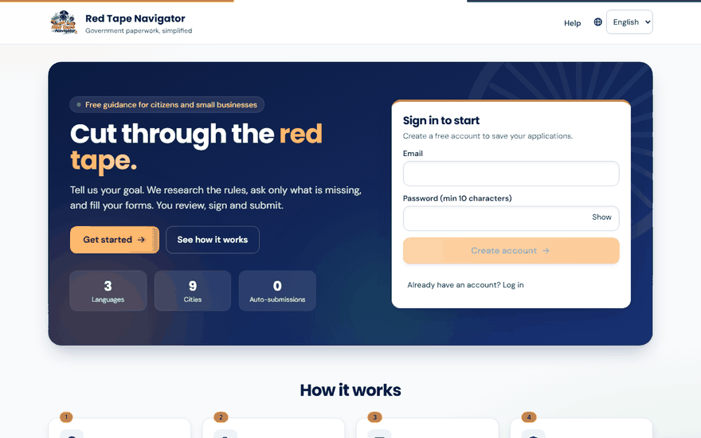

<sub>The real app, recorded from a local run: goal, plan, interview, review, download, then the same journey in Hindi and Bengali.
Full-length demo video: <a href="Onyx_Demo_Video.mp4">Onyx_Demo_Video.mp4</a> &nbsp;·&nbsp; Pitch deck: <a href="Onyx_HackNPitch.pdf">Onyx_HackNPitch.pdf</a></sub>

<br />

> **AI-assisted guidance, not legal advice.** Every figure is cited to an official source. Verify with the issuing authority before you rely on it.
> **The citizen reviews, signs and submits. The system never submits anything to a government portal on its own.**

</div>

---

## Contents

| | | |
|---|---|---|
| 1. [Hackathon and team](#-hackathon-and-team) | 7. [The workflow, step by step](#-the-workflow-step-by-step) | 13. [Challenges we faced and how we solved them](#-challenges-we-faced-and-how-we-solved-them) |
| 2. [The problem statement in full](#-the-problem-statement-in-full) | 8. [How the app works: what does what](#-how-the-app-works-what-does-what) | 14. [Quality and testing](#-quality-and-testing) |
| 3. [The problem, in real life](#-the-problem-in-real-life) | 9. [Every feature](#-every-feature) | 15. [Honest status](#-honest-status-real-simulated-untested) |
| 4. [Who we are building this for](#-who-we-are-building-this-for) | 10. [Screenshots](#-screenshots-of-the-running-app) | 16. [Pending work and roadmap](#-pending-work-and-roadmap) |
| 5. [How the Indian government context shaped us](#-how-the-indian-government-context-shaped-the-design) | 11. [Technology and tools](#-technology-and-tools-we-used) | 17. [Our vision](#-our-vision) |
| 6. [Our approach and plan](#-our-approach-and-plan) | 12. [Architecture and pipelines](#-architecture-and-pipelines) | 18. [Quick start](#-quick-start) · [Docs](#-documentation-index) · [License](#-license) |
| **+** [Where the agentic AI is](#-where-the-agentic-ai-is) | | |

---

## 🏁 Hackathon and team

<table>
<tr>
<td width="50%" valign="top">

**Hackathon:** HackNPitch
**Institution:** Jadavpur University
**Team name:** **Team Onyx**
**Project:** Red Tape Navigator
**Track:** Agentic AI, Software and Civic Tech
**Problem statement:** *Agentic AI: The "Red Tape" Bureaucracy Navigator*

</td>
<td width="50%" valign="top">

**Team members**

| Member | Role |
|---|---|
| **Rajdip Dhar** | **Team Leader** |
| **Raktim Chakraborty** | Team member |
| **Anish Goswami** | Team member |
| **Imon Patra** | Team member |

</td>
</tr>
</table>

Our submission materials live in this repository: the [pitch deck (PDF)](Onyx_HackNPitch.pdf), the [editable deck (PPTX)](Onyx_HackNPitch.pptx)
and the [demo video](Onyx_Demo_Video.mp4).

---

## 📜 The problem statement in full

> The text below is the problem statement we were given, reproduced in full. The same text is kept in [`Problem_Statement.md`](Problem_Statement.md).

### Agentic AI: The "Red Tape" Bureaucracy Navigator

**Problem Statement.** Everyday citizens and small business owners waste weeks trying to navigate the maze of local government bureaucracy. Whether applying for a neighbourhood food vendor license, securing residential zoning permits, or accessing agricultural grants, the process is usually buried in confusing departmental websites, outdated PDF forms, and contradictory requirements that require a legal or administrative background to understand.

**Challenge.** Build an autonomous "Red Tape" AI Agent that acts as a proactive legal-administrative assistant. The agent should take a simple, natural language goal (e.g., "I want to open a small bakery in my town") and independently research local regulations, fetch the correct forms, interview the user for missing details, and auto-fill the required paperwork for submission.

**Key Requirements.**

1. A web-scraping and reasoning agent capable of navigating unstructured, text-heavy government or municipal portals to extract accurate, up-to-date compliance steps.
2. An interactive memory system that allows the agent to conduct a conversational "interview" with the user, asking only for the specific personal or business details needed for the application.
3. Document processing tools that allow the agent to map the collected information and autonomously populate official PDF forms or digital web portals.
4. A transparency and review checkpoint where the agent presents the finalized, filled-out forms and a summary of the regulations to the user for final signature and submission.

### How each requirement is met

| # | Requirement | What we built | Where it lives |
|---|---|---|---|
| 1 | Scraping and reasoning agent over text-heavy portals | A **guarded fetcher** (HTTPS only, domain allowlist re-checked on every redirect, `robots.txt`, rate limit, size cap, CAPTCHA or login means a human hand-off), a **sanitiser** against prompt injection, and a **research agent** that builds a dependency-ordered plan from a cited rules knowledge base. A live-refresh mode keeps a claim only if its quote appears **verbatim** on the official page. | `backend/app/scraping/`, `backend/app/agent/`, `backend/app/kb/` |
| 2 | Interactive memory and a conversational interview | An **interview engine** that asks one or two questions at a time, validates every answer (PAN, Aadhaar checksum, PIN, IFSC, dates), never asks twice, and stores sensitive answers **encrypted**. | `backend/app/interview/` |
| 3 | Document processing and form filling | A **PDF filler** (AcroForm fill or flat-PDF overlay) with per-field provenance, and a **key-in sheet** for online-only portals such as FoSCoS and Udyam. | `backend/app/forms/` |
| 4 | Transparency and review checkpoint | A side-by-side **review screen** with editable fields, a plain-language summary and an explicit consent tick-box. Any later edit invalidates the review. **No code path submits to a government portal** (a test fails if one is added). | `frontend/components/ReviewView.tsx`, `backend/app/api/sessions.py` |

---

## 🌆 The problem, in real life

Behind the statement are real people: a baker in Mysuru, a sweet-maker in a Kolkata lane, a tea-stall owner in Madhya Pradesh, a wholesaler in Burrabazar.
Each of them is told to "get the licences" and then has to work out **which** ones, **in what order**, **from which office**, **with which documents**, **at what cost**.

<table>
<tr>
<td align="center" width="50%">
<br />
<sub><b>A street vendor preparing malpua, Kolkata.</b> Food vendors need FSSAI registration and often a municipal trade licence.<br />Photo: Salil Kumar Mukherjee, <a href="https://commons.wikimedia.org/wiki/File:A_street_vendor_preparing_Malpua_Sweet_in_Kolkata,_India.jpg">Wikimedia Commons</a>, CC BY-SA 4.0</sub>
</td>
<td align="center" width="50%">
<br />
<sub><b>A neighbourhood bakery, Mysuru.</b> Our own example goal: "open a small bakery".<br />Photo: Sunnya343, <a href="https://commons.wikimedia.org/wiki/File:Sri_Krishna_Bakery_in_Mysuru,_July_2013.jpg">Wikimedia Commons</a>, CC BY-SA 4.0</sub>
</td>
</tr>
<tr>
<td align="center" width="50%">
<br />
<sub><b>Burrabazar, Kolkata.</b> Thousands of small traders, each with their own set of registrations.<br />Photo: Kritzolina, <a href="https://commons.wikimedia.org/wiki/File:Burrabazar_Market_in_Kolkata_03.jpg">Wikimedia Commons</a>, CC BY-SA 4.0</sub>
</td>
<td align="center" width="50%">
<br />
<sub><b>A tea-shop owner, rural Madhya Pradesh.</b> The smallest businesses have the least time for paperwork.<br />Photo: McKay Savage, <a href="https://commons.wikimedia.org/wiki/File:Teashop_owner_in_rural_MP_(5102712755).jpg">Wikimedia Commons</a>, CC BY 2.0</sub>
</td>
</tr>
</table>

### The pain, point by point

| What the citizen faces today | What it costs them |
|---|---|
| Rules are scattered across **central, state and municipal** websites, each with its own layout. | Days spent just finding the right page. |
| Forms are **outdated PDFs**, or portals that only accept typed input. | Re-typing the same name, PAN, Aadhaar and address into every form. |
| Requirements **contradict** each other between departments and between cities. | Wrong documents, rejected applications, repeat visits. |
| The order matters (for example Udyam first, then FSSAI, then trade licence) but nobody states it. | Applications filed in the wrong sequence and sent back. |
| Fees and timelines are rarely written down in one place. | No budget and no schedule; a business that cannot plan its opening day. |
| Language: official text is mostly English; many owners think in Hindi or Bengali. | Dependence on middlemen who charge for what should be free guidance. |
| Sensitive identity data is handed to anyone who "helps". | Privacy and fraud risk. |

---

## 🎯 Who we are building this for

| Persona | A day in their life | What Red Tape Navigator gives them |
|---|---|---|
| **The first-time shopkeeper** (bakery, cafe, tea stall, cloud kitchen, sweet shop, grocery) | Has the recipe and the lease; has never filed a government form. | A single ordered checklist with authority, fee, timeline and documents for each step, each cited. |
| **The street vendor and home-food entrepreneur** | Works from a cart or a home kitchen; cannot afford an agent. | Plain-language steps, free of charge, in their own language. |
| **The small business owner expanding** (second outlet, new city, new line of business) | Knows some rules, but not the new city's. | City-specific rules for nine cities, state-specific licences shown per state. |
| **The regulated-sector founder** (clinic, pharmacy, school, coaching centre, jewellery, liquor retail) | Faces state laws that differ sharply. | State-by-state sourced rules, and an honest "no ordinary private route in this state" notice where that is true. |
| **The Common Service Centre (CSC) operator and professional helper** | Files for many citizens every day. | Teams and workspaces to share a case with a colleague; reminders; downloadable plans. |
| **The government officer or reviewer** | Wants the information the public sees to be correct. | An officer console where every rule is **verified, corrected or rejected**, with an audit trail. |

---

## 🇮🇳 How the Indian government context shaped the design

Red Tape Navigator is built around the way Indian public services actually work. The references below are the official systems and laws the product points to
or complies with. **We use them as sources and as guard-rails. We do not represent any government body, and this is not an official service.**

| Government system or law | How it appears in the product |
|---|---|
| **Udyam Registration** (Ministry of MSME) | The first step in most small-business plans. We fill the details sheet and give a key-in sheet for the portal. |
| **FSSAI and FoSCoS** (Food Safety and Standards Authority of India) | Food Business Registration or Licence, with the fee slabs read from FSSAI documents. We build a key-in sheet because FoSCoS is an online-only portal. |
| **GST registration** (GST Council, GSTN) | Included as a step where turnover thresholds apply, with the threshold and timeline cited. |
| **Municipal trade licence and Shops and Establishments Acts** | State and city specific: Kolkata, Mumbai, Delhi, Bengaluru, Chennai, Hyderabad, Pune, Ahmedabad and Surat, each with its own authority and fee structure. |
| **Fire, pollution-board and labour approvals** | Shown with authority and conditions where we could read an official source. |
| **State excise, drugs, clinical-establishment and education rules** | Liquor retail, retail drug licence, clinic and hospital registration, bio-medical waste, school recognition, college approval and coaching registration, each marked as state-specific. |
| **BIS hallmarking** | Included for jewellers. |
| **Digital Personal Data Protection Act, 2023 (DPDP)** | Explicit consent, purpose limitation, retention purge, export and erase, grievance contact, encrypted sensitive fields. See [`docs/COMPLIANCE.md`](docs/COMPLIANCE.md). |
| **Information Technology Act, 2000** and **Aadhaar (e-Sign) framework** | We integrate **Digio** for Aadhaar e-Sign and DigiLocker, with a signed webhook and a separate consent. |
| **DigiLocker** and **UMANG** (MeitY, Digital India) | Document-fetch flow built against Digio's DigiLocker API; a UMANG adapter is mocked and labelled. |
| **State Emblem of India (Prohibition of Improper Use) Act, 2005** | The team-designed logo shows the national emblem on the robot officer's cap. The 2005 Act restricts use of the emblem, so **before any public launch this must be reviewed by counsel and either authorised by the competent authority or replaced with a neutral cap badge**. Tracked in [`docs/LAUNCH_CHECKLIST.md`](docs/LAUNCH_CHECKLIST.md). |
| **Digital India, Ease of Doing Business and Startup India** | The wider push to make compliance simple is the reason this problem is worth solving. We are a citizen-side helper, not a replacement for any of these portals. |

The product text is always written to be honest about its limits: where we could not read an official source, the app says so and routes the item to an officer review
instead of inventing a rule.

---

## 🧭 Our approach and plan

### The question we asked first

> *How do we build an agent that does the research and the paperwork, **without** ever becoming something a citizen cannot trust?*

A bureaucracy agent that invents a fee or files a wrong form is worse than no agent. So we did not start with a model. We started with **principles**, and let the model sit inside them.

### Six principles

| Principle | What it means in the product |
|---|---|
| **1. Human in the loop** | The citizen reviews every form and ticks an explicit consent box. Any later edit invalidates the review. There is **no code path that submits** to a government portal. |
| **2. Ask only what is missing** | The interview engine asks one or two questions at a time, validates each answer, remembers earlier answers and never asks twice. |
| **3. Every claim is cited** | Each fee, timeline, authority and document list carries a source URL, a fetch time, a content hash and a confidence score. Low confidence shows "verify with the authority". |
| **4. Honest about limits** | If we have no sourced rules for a business type or state, we say so, or route it to an officer. We never make up a checklist. |
| **5. Privacy by design** | DPDP-style consent, encrypted Aadhaar, PAN and bank answers, a hash-chained audit log, retention purge, export and erase. |
| **6. Three languages, free for everyone** | English, Hindi and Bengali across the interface and the backend text. No billing, price list or paywall exists in the code. |

### The plan we followed

| Phase | Goal | What we delivered |
|---|---|---|
| **0. Understand** | Read the problem and real government sites; decide what "correct" means. | Assumptions, architecture and task plan (`docs/ASSUMPTIONS.md`, `docs/ARCHITECTURE.md`). |
| **1. Core product** | Goal in, cited plan out, forms filled, human reviews. | Auth, consent, audit log, scraping guard, research agent, rules KB, interview engine, form filler, review checkpoint, officer console. |
| **2. Production readiness** | Make it safe to run for real people. | Email, password reset, lockout, privacy export and erase, retention purge, deployment blueprints, UI redesign. |
| **3. Integrations** | Real signing and identity. | Digio e-Sign and DigiLocker adapters with a signed webhook, tested against mocks. |
| **4. Rules and coverage** | Replace generic rules with sourced ones. | 120 business types, 9 cities, 16 licences, 438 rules, state-specific liquor, drug, clinic and school rules. |
| **5. Quality and CI** | Trust the build. | 7 CI jobs, PostgreSQL parity, security scans, browser end-to-end tests, evaluation set with a hallucination gate. |
| **6. Language** | Reach people in their own language. | Complete Hindi and Bengali (interface **and** backend text). |
| **7. Delight** | Make the journey feel good. | Progress ring, confetti when the checklist is done, print and WhatsApp share, reduced-motion support. |
| **8. Hardening and the Document Vault** | Safe document storage and provider readiness. | Private vault with magic-byte checks, redaction before any model call, resilient adapters, help centre, disaster-recovery runbook. |
| **9. AI provider choice** | Optional model help, free to run. | One switch for a local Ollama model or Google Gemini, with a circuit breaker and a deterministic rules-only fallback. |

---

## 🤖 Where the agentic AI is

Red Tape Navigator is an **agent**, not a chatbot. You give it a **goal** ("open a small bakery in Kolkata"); it then decides what to do, uses tools to do it, remembers what you told it, checks its own work, and stops at a human checkpoint. The language model is one optional tool inside that loop, not the whole product.

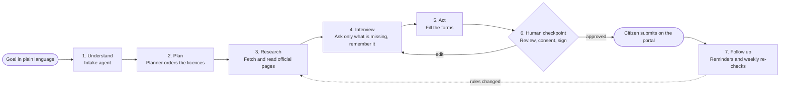

| Agentic ability | How we implemented it | Where |
|---|---|---|
| **Goal understanding** | Turns free text into a business type, city and state. It is rules-first (keywords, typos, regulated-sector checks); an optional model fills gaps, and its answer is validated against our catalogue so it cannot invent a business type. | `backend/app/agent/intake.py` |
| **Planning** | Breaks the goal into an ordered, dependency-aware list of licences (for example Udyam, then FSSAI, then trade licence). | `backend/app/agent/planner.py` |
| **Tool use** | Calls tools on its own: a guarded web fetcher for official pages, a page reader that extracts claims, a PDF form filler, an e-Sign adapter, email and SMS adapters. | `backend/app/scraping/`, `backend/app/forms/`, `backend/app/integrations/` |
| **Memory** | Remembers every answer, encrypts the sensitive ones, and never asks the same question twice. | `backend/app/interview/` |
| **Self-checking** | Keeps a model-extracted fact only if its quote appears word for word on the official page; validates every answer; an evaluation set in CI fails the build if the agent invents a fact. | `backend/app/agent/research.py`, `backend/evals/` |
| **Proactive follow-up** | Without being asked, it schedules status checks and renewal reminders, and re-checks rules every week. | `backend/app/jobs/`, `backend/app/followup/` |
| **Bounded autonomy** | It may research, ask, fill and remind. It may **not** submit: no interface has a submit method, and a test fails if one is added. | `backend/app/integrations/interfaces.py` |

**Which model?** One switch (`LLM_PROVIDER`) selects a local Ollama model or Google Gemini. Personal data is redacted before any model call, a circuit breaker keeps a slow model from blocking the user, and if no model is available the agent still works in its deterministic rules-only mode.

---

## 🔄 The workflow, step by step

<table>
<tr>
<td width="50%" valign="top">

### 1. Sign in and consent

Email and password, optional two-factor sign-in with an authenticator app, and a **DPDP consent** screen: a required "service" consent, an optional "reminders" consent, and a separate consent before any identity-provider (Digio) sharing.

</td>
<td width="50%" valign="top">
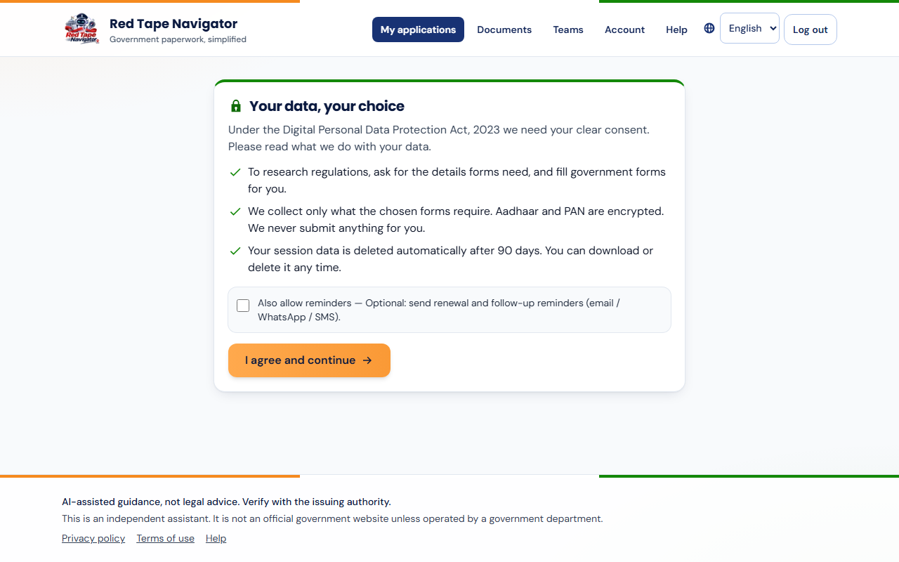
</td>
</tr>
<tr>
<td width="50%" valign="top">
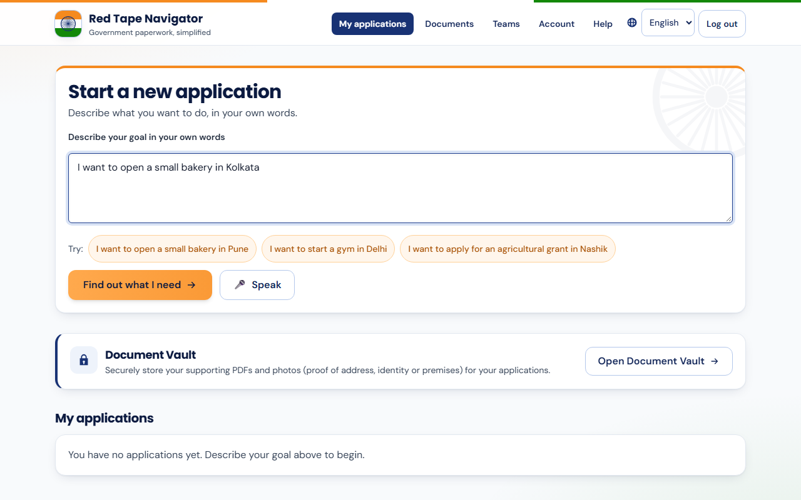
</td>
<td width="50%" valign="top">

### 2. Say the goal in plain language

"I want to open a small bakery in Kolkata", in English, Hindi or Bengali. **Intake** extracts the business type, city and state. If something is missing it asks **one** question (place first, then business type). Common spelling mistakes ("resturent") are understood.

</td>
</tr>
<tr>
<td width="50%" valign="top">

### 3. Research and the step-by-step plan

The agent builds an **ordered, dependency-aware plan** (for example Udyam, then FSSAI, then trade licence) with authority, fee, timeline and documents for each step. **Every line shows its source, the date it was checked, a confidence score and a content hash**.

</td>
<td width="50%" valign="top">
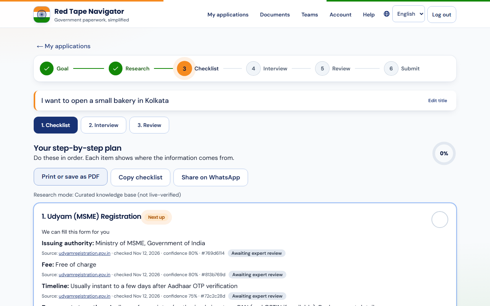
</td>
</tr>
<tr>
<td width="50%" valign="top">
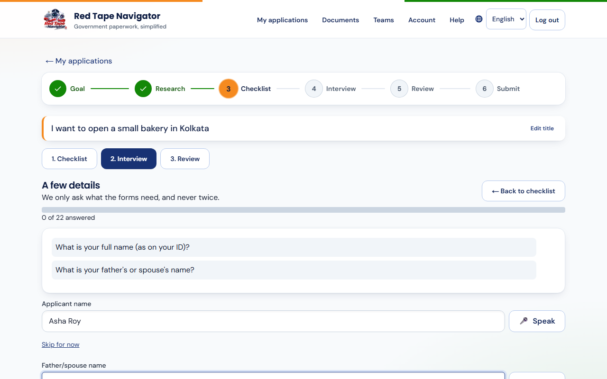
</td>
<td width="50%" valign="top">

### 4. The interview: only what is missing

Conversational questions, one or two at a time, each **validated** (PAN format, Aadhaar Verhoeff checksum, PIN code, IFSC, dates). Aadhaar, PAN and bank answers are **encrypted** at rest. The progress bar and milestone cheers keep the citizen going.

</td>
</tr>
<tr>
<td width="50%" valign="top">

### 5. Forms filled, then a review checkpoint

Official PDFs are filled automatically (AcroForm fill or flat overlay); online-only portals get a **key-in sheet**. The review screen shows a **side-by-side preview with editable fields**, the provenance of each value, and a plain-language summary. The citizen must tick the consent box before anything can be downloaded or signed.

</td>
<td width="50%" valign="top">
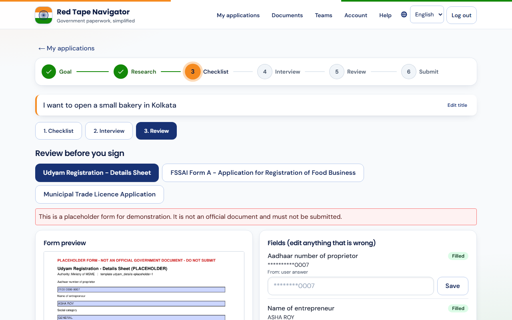
</td>
</tr>
<tr>
<td width="50%" valign="top">
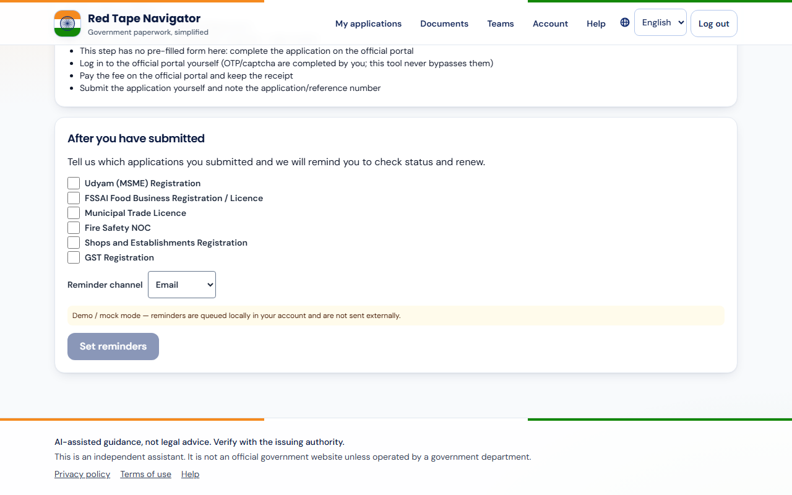
</td>
<td width="50%" valign="top">

### 6. Download, sign, submit yourself, follow up

Download the filled PDF, optionally **e-Sign with Aadhaar** (Digio), follow the submission checklist and **submit on the official portal yourself**. When the citizen says they have submitted, **status-check and renewal reminders** are scheduled (email now, SMS once live) and can be exported to a calendar.

</td>
</tr>
</table>

---

## ⚙️ How the app works: what does what

### System view

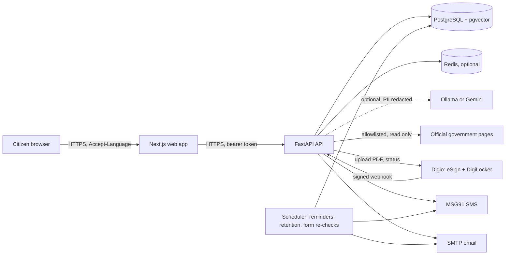

### The life of one citizen goal

```text
goal text
  -> intake        rules first (keywords incl. typos, regulated-sector check, city and state); an optional model fills gaps, then is validated against the catalogue
  -> clarify       asks place, then business type; keeps earlier answers
  -> research      plan = licences in dependency order + cited claims from the knowledge base; adds notes and officer-review items
  -> interview     only the missing fields; validators; encrypted memory
  -> form fill     AcroForm or flat overlay; per-field provenance; key-in sheet for online-only portals
  -> review        explicit consent; invalidated by any edit
  -> download / e-Sign   Digio: upload reviewed PDF -> signing link -> signed webhook -> signed copy
  -> citizen submits on the official portal   (never the system)
  -> reminders     status check and renewal, in the citizen's language
```

### What each part does

| Part | Where | What it does |
|---|---|---|
| **Intake agent** | `backend/app/agent/intake.py` | Turns free text into business type, city and state; handles typos and regulated sectors. |
| **Planner** | `backend/app/agent/planner.py` | Orders licences by dependency. |
| **Research agent** | `backend/app/agent/research.py` | Builds the plan with cited claims; seeds missing licences on demand. |
| **LLM wrapper** | `backend/app/agent/llm.py` | One switch (`LLM_PROVIDER`) for Ollama, Gemini or none; redacts personal data first; circuit breaker and fail-fast retries; deterministic fallback. |
| **Rules knowledge base** | `backend/app/kb/` | Catalogue of licences, 9 cities, 120 business types, sourced licences; claims carry source, hash, confidence. |
| **Scraping guard** | `backend/app/scraping/` | Allowlist, robots.txt, redirect re-checks, size caps, sanitiser. SSRF and prompt-injection defence. |
| **Interview engine** | `backend/app/interview/` | Field definitions, validators, question engine, encrypted memory. |
| **Forms** | `backend/app/forms/` | Template registry, PDF filler, official-PDF fetch with officer approval, key-in sheets. |
| **Follow-up** | `backend/app/followup/` | Submission checklist and reminders (email, SMS, calendar file). |
| **Integrations** | `backend/app/integrations/` | Interfaces with labelled mocks, plus real Digio, MSG91, SMTP and UMANG adapters. **No interface has a "submit" method.** |
| **API** | `backend/app/api/` | Auth, consent, sessions (the main flow), privacy, admin (officer console), webhooks, workspaces, documents. |
| **Core** | `backend/app/core/` | Config, security, encryption, hash-chained audit log, middleware (headers, limits, metrics), translation middleware, vault storage and scanner. |
| **Jobs** | `backend/app/jobs/` | Reminders, retention purge and weekly rule re-checks, as a worker or inside the API. |
| **Translation** | `backend/app/i18n_content/` + `frontend/messages/` | Hindi and Bengali tables for backend text; interface strings for all three languages. |
| **Web app** | `frontend/` | Next.js App Router, next-intl, Tailwind, the citizen journey, officer console, Document Vault, help centre. |

### The rules pipeline (why you can trust the numbers)

```text
catalog.py (licences, 9 cities) + sourced_licences.py (read from official documents; state-specific by city)
  + business_types.py (120 types mapped to licence sets)
      -> seed_loader.py -> claims (text, source_url, hash, confidence)
      -> verify_sources.py  reports which numbers appear on the live official page (never marks anything verified by itself)
      -> officer console review queue: verified / corrected / rejected, every decision audited
      -> optional live refresh: a claim is kept only if its quote appears verbatim on the page
```

---

## ✨ Every feature

### For the citizen

- **Natural-language goal** in English, Hindi or Bengali, with spelling-mistake tolerance.
- **Dependency-ordered licence plan**: authority, fee, timeline, documents, **with a citation for every line**.
- **9 cities, 120 business types, 16 licences**, including state-specific liquor, drug, clinic, school and coaching rules.
- **Honest coverage notes** for regulated sectors we cannot fully source (bank, insurance, post office and similar).
- **Conversational interview** that asks only what is missing and never twice.
- **Validators** for PAN, Aadhaar (Verhoeff checksum), mobile, PIN code, IFSC, dates.
- **Auto-filled forms** with per-field provenance and a **key-in sheet** for FoSCoS and Udyam.
- **Review checkpoint** with editable fields, plain-language summary and a mandatory consent tick-box.
- **Aadhaar e-Sign and DigiLocker** through Digio (demo-labelled until credentials exist).
- **Submission checklist** and **reminders** by email and SMS, plus **calendar (.ics) export**.
- **Print or save as PDF**, copy the checklist, **share to WhatsApp** (licence names only, never personal data).
- **Document Vault**: private upload of PDF, PNG and JPEG up to 5 MB with magic-byte checks and per-owner isolation.
- **Progress ring, badges and confetti** (skipped when the system asks for reduced motion).
- **Voice input** for the goal and a **Help centre** with searchable common questions.
- **Fully free**: no billing, price list or paywall in the code.

### For teams and professionals

- **Workspaces** with owner, admin and member roles; **invitation links** the inviter shares; sessions stay private until their owner shares one into a team.
- **Email confirmation** and **two-factor sign-in** (TOTP, RFC 6238) with eight one-time recovery codes.

### For officers and reviewers

- **Officer console**: review queue where each rule is **verified, corrected or rejected**; official PDF fetch and approval; audit-chain check.
- **Rule freshness check** in CI, and a reviewer worksheet export (`docs/RULES_REVIEW_EXPORT.csv`).

### Privacy and security

- **DPDP-style consent** per purpose (service, reminders, identity providers), **export and erase** of personal data, **retention purge**.
- **Field-level encryption** (Fernet) for Aadhaar, PAN and bank answers; **PII redaction** in logs and before any model call.
- **Rotating refresh tokens with reuse detection**, account lockout, constant-cost login, rate limiting.
- **Hash-chained audit log**, signed provider webhooks, CSP and HSTS headers, non-root containers, dependency and secret scans in CI.
- **Allowlisted outbound fetching** (SSRF defence) and **prompt-injection defences**.

### Reliability and operations

- **Health, liveness and readiness endpoints**, Prometheus metrics, OpenTelemetry, optional Sentry, JSON logs with request ids.
- **Backup-and-restore drill in CI**, disaster-recovery runbook, scheduler inside the API for single-instance hosting.
- **Deployment blueprints** for Render and Vercel, Docker Compose with Caddy, and a Terraform skeleton.

---

## 🖼️ Screenshots of the running app

All images below were captured from the real application running locally (English unless stated).

| Landing and sign-in | Cited plan (full page) |
|---|---|
| 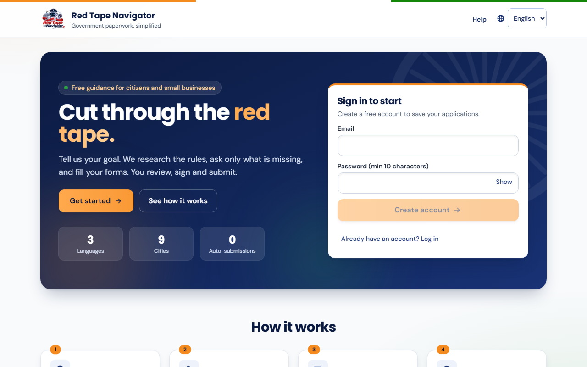 | 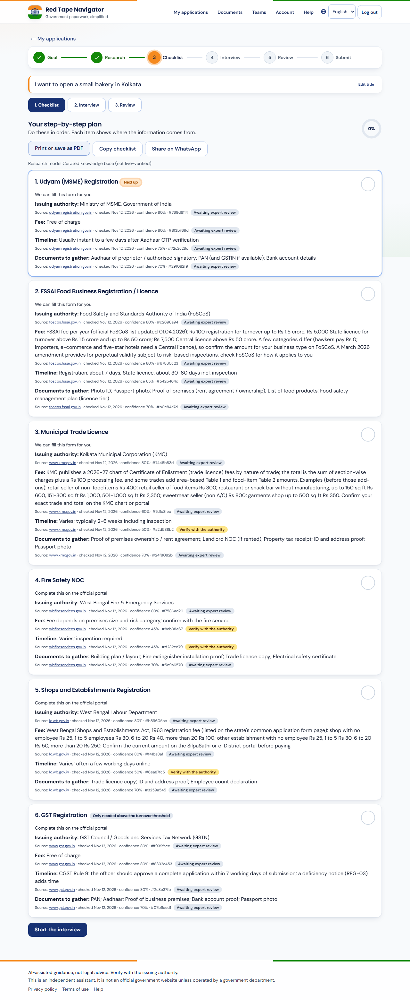 |
| **Review: official-style FSSAI Form A** | **Ready to sign and submit** |
| 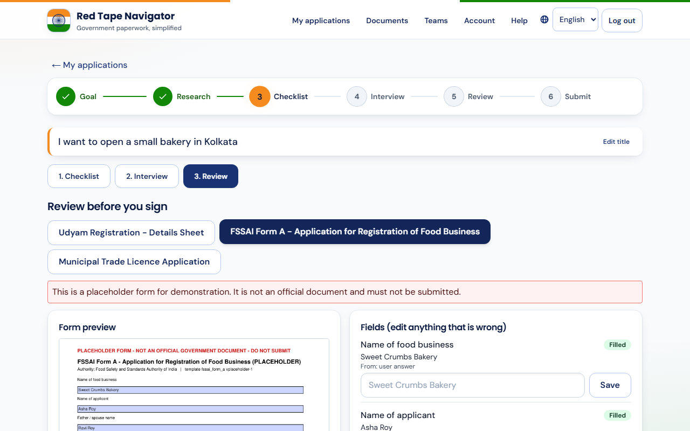 | 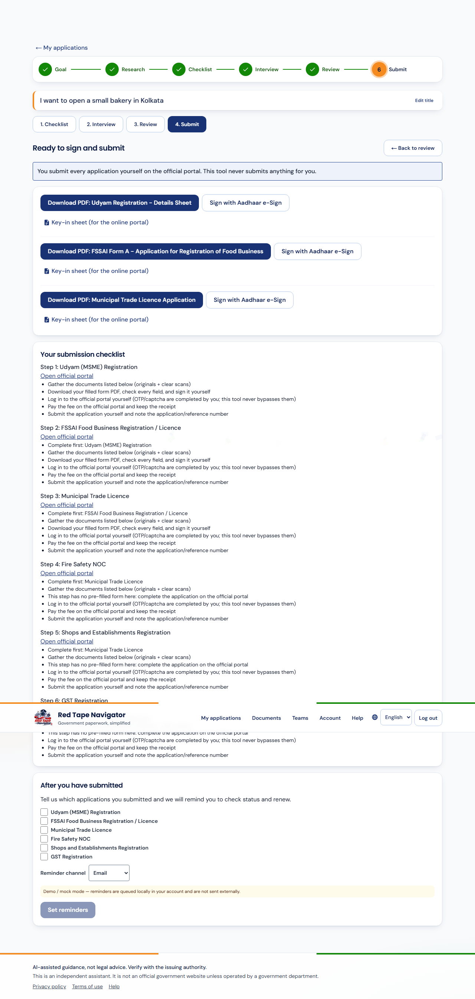 |
| **Hindi (हिन्दी)** | **Bengali (বাংলা)** |
| 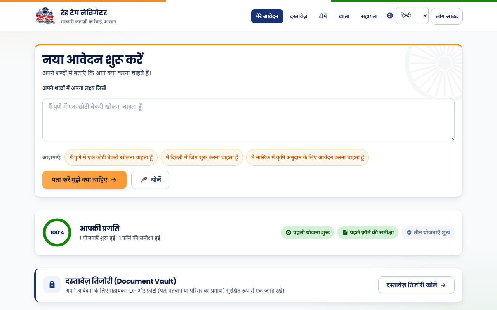 | 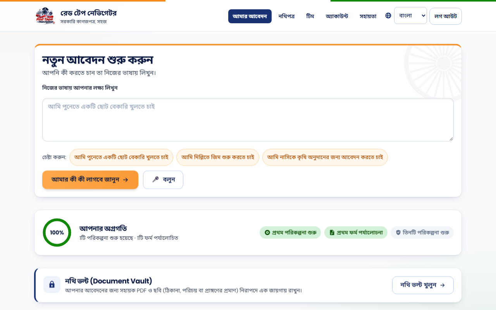 |
| **My applications dashboard** | **Document Vault** |
| 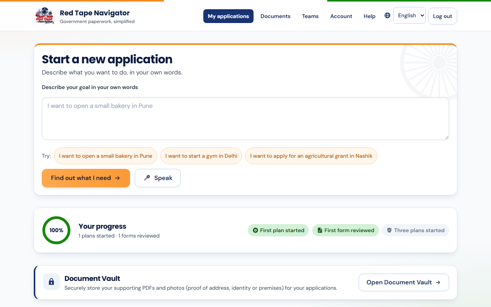 | 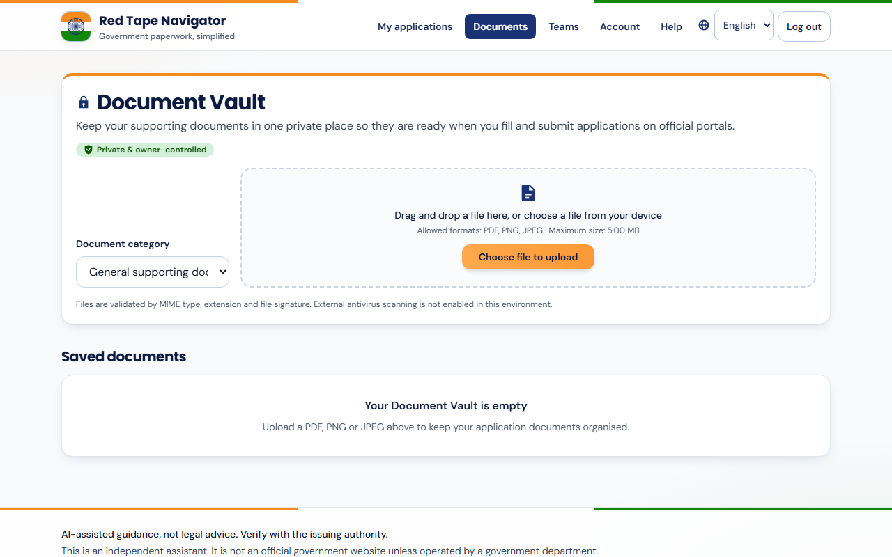 |
| **Account, privacy and two-factor** | **Help centre** |
| 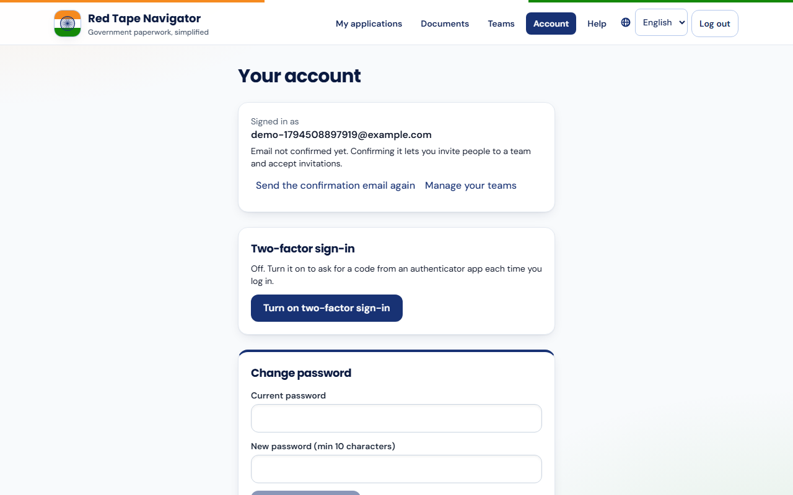 | 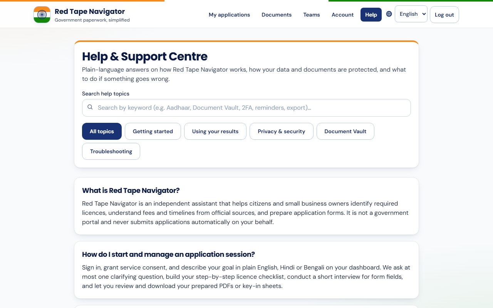 |

<div align="center">

**Phone-sized screen (Pixel 7 emulation)**

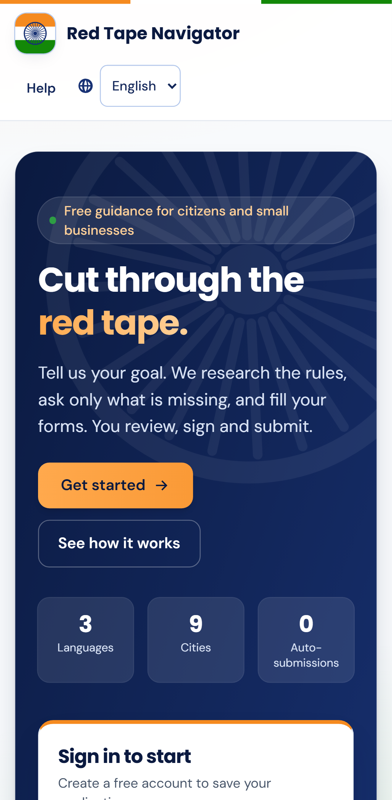

</div>

> The form shown is a **watermarked placeholder** ("not an official government document, do not submit"). Real FSSAI and department forms are loaded only after the
> authority gives permission. The identity numbers in these screenshots are test values that pass the checksums.

---

## 🧰 Technology and tools we used

| Area | Used |
|---|---|
| **Backend** | Python 3.12+, FastAPI, Uvicorn, Pydantic v2, SQLAlchemy 2 (async), Alembic (nine migrations), asyncpg and aiosqlite, ARQ worker, Redis, httpx |
| **Database** | PostgreSQL with pgvector (production), SQLite (local development and tests) |
| **AI (optional, free to run)** | A local **Ollama** model or **Google Gemini** through one provider switch; model names come from environment variables; a deterministic rules-first mode needs no model at all |
| **PDFs and scraping** | PyMuPDF, pypdf, reportlab, trafilatura, Playwright (optional JavaScript rendering), a YAML domain allowlist |
| **Security** | bcrypt, PyJWT, `cryptography` (Fernet), structlog with PII redaction, sliding-window rate limiter |
| **Observability** | Prometheus, OpenTelemetry, optional Sentry, JSON logs |
| **Frontend** | Next.js 15, React 19, TypeScript, next-intl (en, hi, bn), Tailwind CSS, Vitest, Playwright |
| **Quality** | pytest and coverage (gate 80%, actual about 95%), ruff, mypy, eslint, tsc, an evaluation set with a hallucination gate |
| **Security scans** | pip-audit, bandit, npm audit, gitleaks, Trivy (container) |
| **CI** | GitHub Actions, 7 jobs: backend, backend on PostgreSQL with Alembic up and down, frontend, Playwright end-to-end, security, container build and scan, compose smoke test |
| **Hosting** | Render (API, Postgres) and Vercel (web); VPS alternative with Docker Compose and Caddy; Terraform skeleton |
| **Third parties** | Digio (Aadhaar e-Sign and DigiLocker), MSG91 (SMS, with TRAI DLT), an SMTP provider |
| **How we built it** | Claude Code as an engineering assistant, with the Claude in Chrome extension to read official sites and API documents read-only, the `gh` CLI for CI status, and PyMuPDF for PDF extraction |

---

## 🏗️ Architecture and pipelines

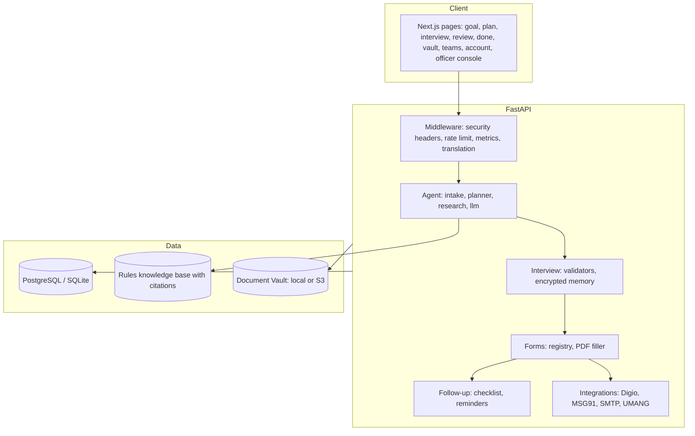

Deployment path: `git push main` triggers GitHub Actions (7 jobs), then the Render Blueprint (`render.yaml` for a zero-cost trial, `render.production.yaml` for launch)
runs `alembic upgrade head` and loads the rules pack, and Vercel serves the web app. Details: [`docs/DEPLOY_NOW.md`](docs/DEPLOY_NOW.md).

---

## 🧗 Challenges we faced and how we solved them

| # | Challenge | How we dealt with it |
|---|---|---|
| 1 | **Government sites are hostile to automation.** Many reset connections, block non-browser clients, hide content behind JavaScript, or publish scanned PDFs. | We read pages in a **real browser, read-only**, extracted PDFs locally with PyMuPDF, recorded every attempt (including dead ends) in `docs/RULES_VERIFICATION.md`, and never bypassed a firewall or CAPTCHA. Where we could not read a source we say so in the product. |
| 2 | **An agent that hallucinates fees is dangerous.** | Rules-first design: the model is optional, every claim needs a source URL and hash, a live refresh keeps a claim only if its quote appears **verbatim** on the page, and an **evaluation set with a hallucination gate** runs in CI (26 golden cases, zero invented facts). |
| 3 | **Sensitive identity data meeting a language model.** | **Redaction** before any model call, field-level encryption at rest, redacted logs, a separate consent for identity providers, and a deterministic fallback so the product works with no model at all. |
| 4 | **"Autonomous" versus "safe".** The brief says auto-fill for submission; the law and common sense say a human must sign. | A **review checkpoint** with an explicit consent box, invalidated by any edit, and an architectural rule that **no interface has a submit method**, enforced by a test. |
| 5 | **We cannot legally ship official forms without permission.** | Three **watermarked placeholder forms** now, a fetch-and-approve workflow for officers, and a request to the authority for permission. |
| 6 | **Rules differ by state and city** (liquor, drugs, clinics, schools). | State-specific `by_city` entries for all nine cities, an explicit "no ordinary private route" notice where true, and catalogue-integrity tests that fail on gaps. |
| 7 | **Hindi and Bengali had to be complete, not decorative.** | A translation middleware for backend text, about 275 strings per language, and tests that fail if an English string is added without a translation or if a full Hindi or Bengali session shows English. |
| 8 | **A model provider that is slow or down** (a real 503 "high demand" from Gemini during testing). | A **circuit breaker** and fail-fast retries, then the deterministic rules-only path. The user never waits on a flaky model. |
| 9 | **Tests that depended on a developer's own settings.** A personal `.env` once changed test results. | **Hermetic tests**: the suite ignores `backend/.env` and blanks every model key; browser tests run the API with the model off. |
| 10 | **Local and CI database differences.** A SQLite-only statement failed the PostgreSQL CI job. | Dialect-guarded setup and a dedicated **PostgreSQL plus pgvector CI job** with migration up, down and up again. |
| 11 | **UI bugs only a real browser shows**: the header and dashboard did not update after sign-in or log-out; download buttons showed raw file names; dates ignored the language; two consent buttons had the same accessible name. | We reviewed the live app in a real browser and fixed each: an `rtn:auth` event keeps the header and dashboard in sync, readable download labels, locale-aware dates, distinct accessible names, and a new end-to-end test. |
| 12 | **Free hosting limits.** Render's free tier sleeps, has no shell and expires its database in 30 days. | A zero-cost trial Blueprint with an in-process scheduler, a first officer created from environment variables, and a documented upgrade path to a production Blueprint. |
| 13 | **Merging two teammates' diverged work** (core product and the hardening and Document Vault branch). | A careful three-way merge with 12 conflicts resolved by hand, then the full test suite and CI to prove nothing regressed. |
| 14 | **Dependency bots opening unwanted pull requests.** | We removed the Dependabot config and recorded it as a rule in the contributor notes. |

---

## 🧪 Quality and testing

| Check | Result |
|---|---|
| Backend tests (pytest) | **491 passing**, coverage **95.4%** (gate 80%) |
| Static analysis | ruff clean, mypy clean (87 source files) |
| AI evaluation set | 26 golden cases, **0 hallucinations**, full citation coverage |
| Rule freshness | 438 of 438 rules checked in CI |
| Frontend | eslint, tsc, **10 unit tests**, production build |
| Browser end-to-end (Playwright) | **13 tests**, desktop and mobile |
| Continuous integration | **7 of 7 jobs passing** on the latest `main` |
| Security scanning | pip-audit, bandit, npm audit, gitleaks, Trivy |

Run it yourself: `make test`, `make lint`, `make eval`, `make e2e`. Full details: [`docs/DEVELOPER_GUIDE.md`](docs/DEVELOPER_GUIDE.md#8-quality-gates-ci-and-testing).

---

## 🔎 Honest status: real, simulated, untested

We would rather state our limits than hide them.

| Area | Status |
|---|---|
| Intake, research, rules, interview, validators, encrypted memory, review, downloads, checklist, reminders | ✅ **Built and tested** |
| Accounts, two-factor sign-in, teams, officer console, privacy export and erase, Document Vault | ✅ **Built and tested** (real email needs SMTP credentials; not yet tried with a physical authenticator app) |
| Rules content | 🟡 **Seeded from official sources, every rule flagged "verify with the authority"**; none signed off by a human reviewer yet |
| Official PDFs | 🟡 **Watermarked placeholders** until the authorities permit the real forms |
| Digio e-Sign and DigiLocker | 🟡 **Built and tested against mocks**; never run against the real sandbox; DigiLocker field mapping deliberately not guessed |
| MSG91 SMS | 🟡 **Built, never sent live** (needs TRAI DLT approval) |
| UMANG and WhatsApp | ⚪ **Mocked and labelled** |
| Hindi and Bengali | 🟡 **Complete in code and tests; native-speaker review pending** |
| Live deployment | ⏳ **Not deployed yet**: the deployment files are ready and waiting for the owner's account values |
| Load test, penetration test, real-device test, pilot | ⏳ **Not done** |

---

## 🛣️ Pending work and roadmap

### Pending (in priority order)

| # | Item | Who | Notes |
|---|---|---|---|
| 1 | **Go live** on Render and Vercel | Owner | Follow [`docs/DEPLOY_NOW.md`](docs/DEPLOY_NOW.md); then run `scripts/verify_deploy.py`. |
| 2 | **Rules verification** by a human reviewer | Reviewer | Mark each rule verified, corrected or rejected in the officer console; close the known gaps in `docs/RULES_VERIFICATION.md`. |
| 3 | **Digio sandbox, then production** | Owner and third party | Run the sandbox checklist; implement DigiLocker mapping from a real response. |
| 4 | **MSG91 SMS live** | Owner | Complete TRAI DLT registration. |
| 5 | **Official forms** with permission | Owner | Ask FSSAI and departments; add field maps; keep the key-in sheets. |
| 6 | **Native-speaker review** of Hindi and Bengali | Reviewers | Especially legal and fee wording. |
| 7 | **Launch hardening** | Owner and counsel | Legal review of privacy and terms; real-phone, screen-reader and slow-network tests; penetration test; secret-rotation plan. |
| 8 | **Pilot** with 5 to 10 shop owners | Team | See [`docs/PILOT_PLAN.md`](docs/PILOT_PLAN.md). |
| 9 | **Rotate any key shared during development** | Owner | Standard hygiene before launch. |

The owner's ordered, click-by-click list with a status for each step is [`docs/OWNER_ACTIONS.md`](docs/OWNER_ACTIONS.md); every go-live item is in [`docs/LAUNCH_CHECKLIST.md`](docs/LAUNCH_CHECKLIST.md).

### Future ideas (not built yet)

- **More cities and states**, then district-level coverage (we left Jaipur and Lucknow out because sources conflicted).
- **Beyond business licences**: residential zoning and building permits, agricultural schemes and grants, ration and welfare applications, which are the other examples in the original problem statement.
- **Real UMANG and WhatsApp** adapters, so reminders and status checks arrive where people already are.
- **Partner portal** for CSC operators and professionals, with delegation and bulk cases.
- **Per-licence landing pages** and a **support-ticket inbox**.
- **Cookie-based sessions** behind a single domain, nonce-based CSP, shared rate limiting.
- **Voice-first flows** and more Indian languages (Tamil, Telugu, Marathi, Gujarati, Kannada and others).
- **DigiLocker field import** so a citizen's verified documents fill the forms with one tap.
- **A government-side API** so departments can publish their rules directly, replacing our scraping with first-party data.

---

## 🔭 Our vision

> **Nobody in India should need a middleman to understand what their own government requires of them.**

We imagine a country where starting a bakery, a clinic, a school or a farm is limited by skill and effort, not by the ability to decode a PDF.
Red Tape Navigator is a step towards that: a **free, multilingual, citizen-side guide** that is honest about what it knows, shows its sources, protects personal data, and
leaves the final decision and signature with the person it serves. In the long run, we want departments to be able to **publish their requirements once** and let any citizen
see them in their own language, in order, with the documents ready.

Three commitments guide every decision:

1. **Trust before automation.** A correct, cited answer beats a fast, confident wrong one.
2. **Inclusion by default.** Free for everyone, in local languages, working on a phone.
3. **Privacy and consent.** The citizen's data is theirs; we collect the minimum and erase it on request.

---

## 🚀 Quick start

Prerequisites: Python 3.12+, Node 20+, Git. Docker is optional.

**Windows shortcut:** after the one-time setup, double-click `Start-Red-Tape-Navigator.bat`.

**Without Docker** (SQLite, no Redis, no model key needed):

```bash
cd backend
python -m venv .venv && . .venv/bin/activate        # Windows: .venv\Scripts\activate
pip install -e ".[dev]"
export DATABASE_URL=sqlite+aiosqlite:///./dev_local.db
alembic upgrade head && python -m app.kb.seed_loader
uvicorn app.main:app --port 8000                     # API docs at /docs in dev

cd ../frontend && npm ci
npm run build && npm run start                       # http://localhost:3000
```

Open <http://localhost:3000>, create an account (password of at least 10 characters), accept the data notice and describe a goal.
With Docker: `make setup && make dev`.

**Optional AI:** set `LLM_PROVIDER=gemini` with `GEMINI_API_KEY` and `GEMINI_MODEL`, or `LLM_PROVIDER=ollama` with `OLLAMA_MODEL`. Leave it unset for the rules-only mode.
Never commit keys. A walkthrough for presenting the app is in [`docs/DEMO_SCRIPT.md`](docs/DEMO_SCRIPT.md).

| Command | What it does |
|---|---|
| `make test` | backend tests with an 80% coverage gate, plus frontend unit tests |
| `make lint` | ruff, mypy, eslint, tsc |
| `make eval` | golden cases, citation coverage and the hallucination gate |
| `make e2e` | Playwright browser tests |
| `make verify-sources` | check cited sources against the live official sites |

---

## 📚 Documentation index

**Start here:** [Developer and operations guide](docs/DEVELOPER_GUIDE.md) (architecture, phase history, configuration reference, lessons learned) ·
[Owner actions](docs/OWNER_ACTIONS.md) · [Launch checklist](docs/LAUNCH_CHECKLIST.md) · [Handoff prompt](docs/HANDOFF_PROMPT.md)

| Topic | Documents |
|---|---|
| **Product and planning** | [Problem statement](Problem_Statement.md) · [Architecture](docs/ARCHITECTURE.md) · [Assumptions](docs/ASSUMPTIONS.md) · [Task history](docs/TASKS.md) · [Business model](docs/BUSINESS_MODEL.md) · [Demo script](docs/DEMO_SCRIPT.md) |
| **Rules and integrations** | [Rules verification log](docs/RULES_VERIFICATION.md) · [Reviewer worksheet](docs/RULES_REVIEW_EXPORT.csv) · [Integrations](docs/INTEGRATIONS.md) |
| **Deploy and operate** | [Deploy now](docs/DEPLOY_NOW.md) · [Vercel and Render](docs/DEPLOYMENT_VERCEL_RENDER.md) · [VPS deployment](docs/DEPLOYMENT.md) · [Runbook](docs/RUNBOOK.md) · [Load test](docs/LOAD_TEST.md) · [Go-live notes](docs/GO_LIVE.md) |
| **Security and compliance** | [Security (OWASP)](docs/SECURITY.md) · [Threat model](docs/THREAT_MODEL.md) · [DPDP compliance](docs/COMPLIANCE.md) |
| **Status and reports** | [Final report](docs/FINAL_REPORT.md) · [Final project audit](docs/FINAL_PROJECT_AUDIT.md) · [Pilot plan](docs/PILOT_PLAN.md) · [Owner background and costs](docs/HUMAN_TODO.md) |

---

## 🙏 Credits and acknowledgements

- **Team Onyx**: Rajdip Dhar (team leader), Raktim Chakraborty, Anish Goswami and Imon Patra.
- **HackNPitch** and **Jadavpur University** for the platform and the problem.
- **Official sources** we read and cite: the Ministry of MSME (Udyam), FSSAI (FoSCoS), the GST Council and GSTN, state and municipal authorities, state excise and
  drugs-control departments, the Bureau of Indian Standards, MeitY (DigiLocker, UMANG), and the text of the Digital Personal Data Protection Act, 2023. We are not affiliated
  with any of them.
- **Open-source software** this project stands on: FastAPI, SQLAlchemy, Alembic, Pydantic, Next.js, React, next-intl, Tailwind CSS, PyMuPDF, pypdf, reportlab, Playwright, pytest and many more.
- **Photographs** in [the problem section](#-the-problem-in-real-life) are from Wikimedia Commons under Creative Commons licences, credited under each image: Salil Kumar Mukherjee,
  Sunnya343 and Kritzolina (CC BY-SA 4.0) and McKay Savage (CC BY 2.0). They are shown from their original locations and remain the property of their authors.
- **Screenshots** and the walkthrough animation are original captures of this project.

---

## 📄 License

**Proprietary, all rights reserved.** Copyright © 2026 **Team Onyx** (owner: RajdipDhar2007).

This repository is **publicly visible for convenience only**; it is **not open-source software**. Visibility grants **no** licence or permission. In short:

| You may | You may not (without written permission) |
|---|---|
| View the repository on GitHub, as the GitHub Terms of Service allow. | Copy, fork or download for reuse; modify or translate; distribute, host or sell; train or evaluate any model or product with it; remove this notice. |
| Use it if you are a member of Team Onyx or approved in writing by the owner. | Compete with the project using any part of the code, rules data, designs, decks or videos. |

The regulatory content is informational only and **not legal advice**. Third-party libraries and official government texts keep their own licences and ownership.
To request permission, contact the repository owner on GitHub: **RajdipDhar2007**.

<details>
<summary><b>Read the full licence text</b> (the same text as the <a href="LICENSE">LICENSE</a> file)</summary>

```text
Red Tape Navigator - Proprietary License
Copyright (c) 2026 Team Onyx (owner: RajdipDhar2007). All rights reserved.

NOTICE: THIS IS NOT OPEN-SOURCE SOFTWARE.

This repository is made publicly visible only for technical convenience. Visibility
does NOT grant any license or permission. No rights are granted to anyone except the
Authorized Persons defined below.

1. AUTHORIZED PERSONS
   "Authorized Persons" means only the members of Team Onyx and any other individual
   the copyright owner has approved in writing (email or a GitHub invitation to this
   repository counts as written approval). Authorized Persons may use, copy, modify
   and run the software solely for the Team Onyx project and only for as long as they
   remain approved.

2. RESTRICTIONS
   Anyone who is not an Authorized Person may NOT, without the owner's prior written
   permission:
   a) copy, clone for reuse, fork for reuse, download for reuse, or reproduce
      any part of the source code, rules knowledge base, data, documents, designs,
      presentations, videos or other materials in this repository;
   b) modify, adapt, translate or create derivative works from them;
   c) distribute, publish, sublicense, sell, lease or host them, in whole or in part;
   d) use them to build, train, fine-tune or evaluate any product, service, dataset
      or machine-learning model, or to compete with this project;
   e) remove or alter this license or any copyright notice.

3. PERMITTED VIEWING
   Strictly as permitted by the GitHub Terms of Service, the public may view the
   repository on GitHub. This does not permit any use listed in section 2.

4. THIRD-PARTY COMPONENTS
   Third-party libraries and official government source texts that this project
   references remain under their own licenses or ownership. This license covers only
   the original work of the copyright owner.

5. NO WARRANTY
   THE SOFTWARE AND CONTENT ARE PROVIDED "AS IS", WITHOUT WARRANTY OF ANY KIND. The
   regulatory information is informational only and is not legal advice. The owner is
   not liable for any claim or damage arising from any use.

6. ENFORCEMENT
   Unauthorized use terminates automatically any permission that may otherwise apply
   and may be enforced under applicable law, including the Copyright Act, 1957
   (India) and the Information Technology Act, 2000, and by DMCA or equivalent
   takedown requests.

To request permission, contact the repository owner through GitHub: RajdipDhar2007.
```

</details>

---

<div align="center">

**Red Tape Navigator** · Team Onyx · HackNPitch · Jadavpur University

*Built so that the next person who wants to open a bakery spends their time baking.*

</div>
