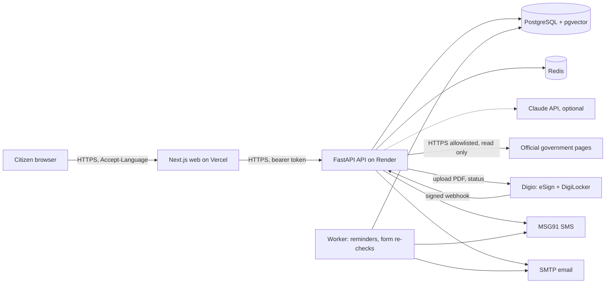

# Red Tape Navigator

An agentic assistant that helps Indian citizens and small-business owners navigate government bureaucracy.
Say your goal in plain language ("I want to open a small bakery in Kolkata"). The app works out which licences you need,
researches the rules from official sources, asks **only** for the details that are missing, fills the official forms, and
shows everything for review. **The citizen reviews, signs and submits. The system never submits anything on its own.**

> AI-assisted guidance, not legal advice. Verify with the issuing authority.

---

## READ THIS FIRST: a request to the next contributor

This README and [`docs/HANDOFF_PROMPT.md`](docs/HANDOFF_PROMPT.md) are the project's memory. Please follow them:

1. **Read this whole README, then `docs/HANDOFF_PROMPT.md` and `docs/LAUNCH_CHECKLIST.md`, before changing anything.**
   The handoff prompt is written so you (or your AI coding assistant) can continue exactly from where the last person stopped.
2. **Do not stop at "it runs on my machine".** The goal is a finished, launched product (section 11). Keep working through the
   pending list (section 10) in order until each item is done or blocked only by something a human must do. When you are blocked,
   say exactly what you need, then continue with everything that does not depend on it.
3. **Never invent legal facts.** Every fee, timeline, document list and rule must come from an official page or document you actually
   read, and be recorded in `docs/RULES_VERIFICATION.md`. If you cannot read it, say so in the product text and ask a human to paste it.
4. **Never commit secrets** (`.env*` except `*.example`, `*.db`, keys, tokens). Never type a password, OTP, Aadhaar or PAN anywhere
   for anyone. Never create accounts, solve CAPTCHAs, or submit to a government portal.
5. **Verify before you claim.** Run the quality gates (section 8) and report real results. Keep CI green. Push small, verified commits.
6. **Keep the docs true.** When you change behaviour, update this README, `docs/LAUNCH_CHECKLIST.md`, `docs/RULES_VERIFICATION.md`
   and `docs/HANDOFF_PROMPT.md` in the same commit. The next person depends on them.
7. Do **not** add `.github/dependabot.yml` (it once opened 12 unwanted pull requests), and do not open PRs, repos or other GitHub
   actions unless the owner asks.

---

## Contents

1. [The problem and the plan](#1-the-problem-and-the-plan)
2. [How the product works (citizen workflow)](#2-how-the-product-works-citizen-workflow)
3. [Architecture and pipelines](#3-architecture-and-pipelines)
4. [What is done, and how it was done](#4-what-is-done-and-how-it-was-done)
5. [Technology and tools used](#5-technology-and-tools-used)
6. [Current status: real, simulated, untested](#6-current-status-real-simulated-untested)
7. [Quick start](#7-quick-start)
8. [Quality gates, CI and testing](#8-quality-gates-ci-and-testing)
9. [How to extend the product](#9-how-to-extend-the-product)
10. [What is pending, how to do it, and what to use](#10-what-is-pending-how-to-do-it-and-what-to-use)
11. [Definition of done](#11-definition-of-done)
12. [Configuration reference](#12-configuration-reference)
13. [Security and compliance](#13-security-and-compliance)
14. [Lessons learned and gotchas](#14-lessons-learned-and-gotchas)
15. [Repository layout and documentation index](#15-repository-layout-and-documentation-index)

---

## 1. The problem and the plan

**Problem** (full text in [`ps.md`](ps.md)): citizens and small businesses lose weeks to scattered departmental sites, outdated PDF
forms and contradictory requirements. They need to know *which* licences apply, *in what order*, *with which documents*, *what it costs*,
and then fill the forms correctly.

**The plan** was to build an agent that does the research and the paperwork, while keeping the human in control:

| Principle | What it means in the product |
| --- | --- |
| Human in the loop | The citizen reviews every form and must tick an explicit consent box. Any later edit invalidates the review. There is no code path that submits to a government portal (a test enforces it). |
| Ask only what is missing | An interview engine asks 1-2 questions at a time, validates each answer (PAN, Aadhaar checksum, PIN, IFSC, dates...), and never asks twice. |
| Every claim is cited | Each fee, timeline, authority and document list carries a source URL, a fetch time, a content hash and a confidence score. Low confidence shows "verify with the authority". |
| Honest about limits | Business types or states we have no sourced rules for get an honest note or an officer review, never a made-up checklist. |
| Privacy by design | DPDP Act consent, encrypted Aadhaar/PAN/bank answers, audit log, retention purge, export and erase. |
| Three languages | English, Hindi, Bengali across the interface and the backend text. |

## 2. How the product works (citizen workflow)

1. **Sign up / log in** (email + password; password reset by email; lockout after repeated failures).
2. **Consent** (DPDP): a required "service" consent, optional "reminders", and a separate "identity providers" consent before data is
   shared with Digio.
3. **Describe the goal** in plain language, in any of the three languages. Intake extracts the business type, city and state.
   If something is missing it asks one question (place first, then business type). Common misspellings are understood.
4. **Research**: the plan is built from the rules knowledge base: an ordered, dependency-aware list of licences (for example Udyam, then
   FSSAI, then trade licence...) with authority, fee, timeline and documents, each with its citation. State-specific licences (such as a
   liquor licence) show that state's own rules; if there is no ordinary private route, a prominent notice says so.
5. **Interview**: only the missing details, with validation. Sensitive answers (Aadhaar, PAN, bank) are encrypted.
6. **Forms**: official PDFs are filled (AcroForm fill or flat-PDF overlay). Online-only portals (FoSCoS, Udyam) get a "key-in sheet".
   Today the three bundled PDFs are watermarked placeholders until the authorities permit the real forms.
7. **Review**: side-by-side preview and editable fields, with provenance for every value and a plain-language summary. The citizen ticks
   the consent box to unlock download / e-Sign.
8. **Done**: download the filled PDF, optionally sign with Aadhaar e-Sign (Digio), follow the submission checklist, and **submit yourself
   on the official portal**.
9. **Follow-up**: when the citizen says they submitted, status-check and renewal reminders are scheduled (email now, SMS via MSG91 once live).

## 3. Architecture and pipelines

### 3.1 System view



### 3.2 The request pipeline (what happens to one citizen goal)

```text
goal text
  -> intake (app/agent/intake.py)        rules first (keywords incl. typos, regulated-sector check, city/state); optional LLM fills gaps,
                                          validated against the catalogue
  -> clarify loop (api/sessions.py)      asks place, then business type; keeps earlier answers; a city answer is never a business type
  -> research (app/agent/research.py)    plan = licences_for(activity) in dependency order (planner.py) + cited claims from the KB;
                                          seeds missing licences on demand; adds notes (coverage, restricted-state) and officer review items
  -> interview (app/interview)           only missing fields; validators; encrypted memory
  -> form fill (app/forms)               AcroForm / flat overlay; field provenance report; key-in sheet for online-only portals
  -> review checkpoint                   explicit consent; invalidated by any edit
  -> download / e-Sign (integrations)    Digio: upload reviewed PDF -> signing link -> signed webhook -> signed copy on demand
  -> citizen submits on the portal       (never the system)
  -> reminders (followup + worker)       status check and renewal, in the citizen's language
```

### 3.3 The translation pipeline

Interface strings live in `frontend/messages/{en,hi,bn}.json` (next-intl). Backend text (licence names, every rule, document lists,
authority names, form titles and field labels, checklists, notices) is stored in English and translated on the way out:
the browser sends `Accept-Language` (`frontend/lib/api.ts`), `LocalizeMiddleware` (`backend/app/core/localize.py`) rewrites JSON responses
for `/sessions/*` using the tables in `backend/app/i18n_content/` (`data_hi.py`, `data_bn.py`, aligned to `source.py`).
Tests fail if an English string is added without a translation, or if a full Hindi/Bengali session still shows English.

### 3.4 The rules pipeline

```text
catalog.py (licences, 8 cities)  +  sourced_licences.py (read from official documents, state-specific by_city)
  + business_types.py (114 types mapped to sourced licence sets)
        -> seed_loader.py -> claims (key licence:scope:category, text, source_url, hash, confidence, seed flag) in the KB
        -> verify_sources.py (reports which numbers appear on the live official page; never marks anything verified)
        -> officer console review queue: verified / corrected / rejected (audited)
        -> optional live refresh: POST /admin/refresh with an LLM; a claim is kept only if its quote appears verbatim on the page
```

### 3.5 Deployment pipeline

`git push main` -> GitHub Actions CI (7 jobs, section 8) -> manual deploy (autoDeploy is off on purpose):
Render Blueprint (`render.yaml`: `rtn-api`, `rtn-worker`, Postgres, Redis; the container entrypoint runs `alembic upgrade head` and loads the
rules pack) + Vercel (frontend, Root Directory `frontend`). Alternative: `docker-compose.prod.yml` + Caddy on a VPS. See
[`docs/DEPLOYMENT_VERCEL_RENDER.md`](docs/DEPLOYMENT_VERCEL_RENDER.md).

## 4. What is done, and how it was done

The work happened in phases (November 2026). Each phase ended with tests, lint and CI green and a commit pushed to `main`.

### Phase 1: the core product (10 steps, see `docs/TASKS.md`)

- **How:** monorepo (`backend/`, `frontend/`, `docs/`, `infra/`), FastAPI + SQLAlchemy async + Alembic, Next.js App Router + next-intl.
- Auth (JWT with rotating refresh tokens and reuse detection, RBAC), DPDP consent, hash-chained audit log, field encryption (Fernet).
- Scraping guard (HTTPS only, domain allowlist re-checked on redirects, robots.txt, rate limit, size cap, captcha/login = human handoff),
  research agent and rules KB with citations, confidence and diffing.
- Interview engine with validators and encrypted memory; form registry and PDF filler with provenance; review checkpoint; officer console.
- Adapter pattern for integrations with clearly labelled mocks. **No interface has a "submit" method** (a test fails if one appears).

### Phase 2: production readiness

- Real SMTP email, password reset (single-use 30-minute links), change password, account lockout, privacy export/erase, retention purge.
- Production config validation that refuses an unsafe start; officer bootstrap (`backend/scripts/create_admin.py`, inside the image).
- Deployment files: `render.yaml`, Vercel guide, `docker-compose.prod.yml` + Caddy, asyncpg URL normalisation for Render.
- UI redesign (tricolour mark, saffron/navy/green palette), a hydration fix, accessibility basics, privacy/terms pages (en/hi/bn) that read
  retention period, hosting region and grievance contact live from the API.
- MSG91 SMS adapter (Flow API), unit-tested with a mocked transport.

### Phase 3: integrations (Digio eSign and DigiLocker)

- **How:** read Digio's documentation in a real browser (it is JavaScript-rendered, in a shadow DOM), then redesigned the interfaces: e-Sign is
  now upload-PDF / signing link / status / signed copy; DigiLocker is start request / wait for consent / status.
- `backend/app/integrations/real/digio.py`, webhook `POST /webhooks/digio` (HMAC `X-Digio-Checksum`, duplicate suppression, optional IP allowlist),
  `external_requests` and `webhook_events` tables (migration 0004), a separate `identity_providers` consent, endpoints and UI for signing.
- 28 unit tests against a mocked Digio. **Never run against the real sandbox** (no credentials yet). DigiLocker data-field mapping is not
  implemented because the response shape was not confirmed; it is deliberately not guessed (`docs/INTEGRATIONS.md`).

### Phase 4: rules, sources and coverage

- **How:** official pages and documents were read in a browser or extracted locally (PyMuPDF, isolated Python) and recorded with their sources
  in `docs/RULES_VERIFICATION.md`; nothing is copied from memory.
- `make verify-sources` now reports numeric versus qualitative claims; a reviewer worksheet is exported (`docs/RULES_REVIEW_EXPORT.csv`, 306 rules).
- **Sourced licences** (`backend/app/kb/sourced_licences.py`): liquor retail (state-specific for all 8 cities: West Bengal, Maharashtra, Delhi,
  Karnataka e-auction from the 01.07.2026 Gazette, Tamil Nadu, Telangana, Gujarat), retail drug licence (Delhi checklist + Drugs Rules), pet shop
  (final Pet Shop Rules 2018), clinic/hospital registration, bio-medical waste, school recognition, college approval, coaching registration, BIS
  hallmarking for jewellers.
- **120 business types** (`backend/app/kb/business_types.py`), including hotel, gold shop, ration shop, pharmacy, school, college, clinic, hospital.
  Regulated sectors with no sourced checklist (bank, insurance, post office...) get an accurate regulator note.
- Licences with extra permits outside the pack carry `coverage="specific"` (the UI says so and an officer is asked to confirm).
- Hyderabad trade licence fee table (GHMC) and Ahmedabad shops-and-establishments (AMC) were added from official pages.

### Phase 5: quality, CI and bug fixes

- Fixed the browser e2e tests (the UI no longer has a demo account: tests now sign up a real account, decide answers by question type, and use
  `/ready` so another app on port 8000 is never mistaken for this one). Fixed the gitleaks CI step (needs `fetch-depth: 0`).
- Fixed: old local SQLite files lacking new columns made login return 500 ("Could not sign in"); `sqlite_upgrade.py` now adds missing columns
  in dev. Fixed: licences added after a KB was seeded showed empty steps (research now loads claims for any licence that has none).
- Fixed the follow-up question flow: a city answer was taken as the business type; earlier answers were forgotten; typos like "resturent" and
  words like "cake" were not recognised.

### Phase 6: full Hindi and Bengali

- About 275 backend strings per language (licence names, all rules, documents, authorities, form titles and field labels), the
  `LocalizeMiddleware`, reminder titles in the citizen's language, and tests that check a complete Hindi and Bengali session. **Native-speaker
  review is still pending.**

## 5. Technology and tools used

| Area | Used |
| --- | --- |
| Backend | Python 3.12+ (3.13 works), FastAPI, Uvicorn, Pydantic v2, SQLAlchemy 2 (async), Alembic, asyncpg / aiosqlite, ARQ worker, Redis, httpx |
| Database | PostgreSQL with pgvector (production), SQLite (local dev and tests) |
| AI | Anthropic API (optional, model name from env, never hard-coded); deterministic rules-first mode needs no key |
| PDFs and scraping | PyMuPDF, pypdf, reportlab, trafilatura, Playwright (optional JS rendering), PyYAML allowlist |
| Security | passlib/bcrypt, PyJWT, cryptography (Fernet / MultiFernet), structlog with PII redaction, in-process sliding-window rate limiter in `core/middleware.py` |
| Observability | Prometheus metrics, OpenTelemetry, optional Sentry, JSON logs with request ids |
| Frontend | Next.js 15.5, React 19, TypeScript 5, next-intl 4 (en/hi/bn), Tailwind CSS 3, Vitest 5, Playwright |
| Quality | pytest + pytest-asyncio + coverage (gate 80%, actual ~95.7%), ruff, mypy, eslint, tsc, evals (golden cases, hallucination gate) |
| Security scans | pip-audit, bandit, npm audit, gitleaks, Trivy (container), CodeQL (opt-in) |
| CI | GitHub Actions: 7 jobs (backend, backend on Postgres + pgvector with Alembic up/down/up, frontend, Playwright e2e, security, container build + scan, compose smoke) |
| Hosting | Render (API, worker, Postgres, Redis; Singapore, no India region), Vercel (web); VPS alternative with Docker Compose + Caddy; Terraform skeleton in `infra/` |
| Third parties | Digio (eSign + DigiLocker), MSG91 (SMS, TRAI DLT), an SMTP provider (SES / Brevo / SendGrid / NIC mail), UptimeRobot-style monitor |
| How the work was done | Claude Code as the engineering assistant, with the Claude in Chrome extension to read official sites and API docs read-only, `gh` CLI for CI status, local PyMuPDF for PDFs |

## 6. Current status: real, simulated, untested

Numbers as of the last update: **401 backend tests** passing (about 95.7% coverage), 5 frontend unit tests, 5 browser e2e tests, **8 cities**,
**120 business types**, **16 licences** (2 state-specific by city), **306 seeded rules**, **3 languages**, **7 CI jobs** green.

| Area | Status |
| --- | --- |
| Intake, research, rules KB, interview, validators, encrypted memory, review, downloads, checklist, reminders | **Built and tested** |
| Accounts, password reset by SMTP, officer console, audit check, privacy export/erase, retention purge | **Built and tested** (SMTP needs real credentials in production) |
| Rules content | **Seed data from official sources, all flagged "verify"**; none signed off by a reviewer yet; gaps listed in `docs/RULES_VERIFICATION.md` |
| Official PDFs | **Watermarked placeholders** (3 forms) until FSSAI / departments permit the real forms |
| Digio eSign and DigiLocker | **Built, unit-tested with mocks, never run against the real sandbox**; DigiLocker field mapping not implemented |
| MSG91 SMS | **Built, never sent live** (needs TRAI DLT approval) |
| UMANG, WhatsApp | **Mocked and labelled** (no real adapters) |
| Hindi / Bengali | **Complete in code and tests; not yet reviewed by native speakers** |
| Privacy / terms pages | **Built**, shown as "draft, pending legal review" until `NEXT_PUBLIC_LEGAL_REVIEWED=true` |
| Production deployment | **Not deployed** (files and guides are ready; needs the owner's logins and secrets) |
| Load test, backup-restore test, pentest, real-device test, pilot | **Not done** |

## 7. Quick start

Prerequisites: Python 3.12+, Node 20+ (CI uses 22), Git. Docker is optional.

**Without Docker** (SQLite, no Redis, no LLM key needed):

```bash
cd backend
python -m venv .venv && . .venv/bin/activate        # Windows: .venv\Scripts\activate
pip install -e ".[dev]"
export DATABASE_URL=sqlite+aiosqlite:///./dev_local.db
alembic upgrade head && python -m app.kb.seed_loader
uvicorn app.main:app --port 8000                     # API (docs at /docs in dev)

cd ../frontend && npm ci
npm run dev                                          # http://localhost:3000 (or: npm run build && npm run start)
```

Open <http://localhost:3000>, **create an account** (any email, password of at least 10 characters), accept the data notice and describe a goal.
With `DEMO_MODE=true` (the default) e-Sign and other unconfigured integrations show a labelled "Demo mode: simulated" message. Walkthrough:
[`docs/DEMO_SCRIPT.md`](docs/DEMO_SCRIPT.md).

With Docker: `make setup && make dev` (db, redis, api, worker, web).

| Command | What it does |
| --- | --- |
| `make setup` / `make dev` / `make stop` | install / run the whole stack / stop |
| `make test` | backend pytest (**coverage gate 80%**) + frontend unit tests |
| `make lint` | ruff, mypy, eslint, tsc |
| `make eval` | golden cases, citation coverage, hallucination gate |
| `make e2e` | Playwright end-to-end |
| `make smoke` | demo scenario through the API of a running stack |
| `make migrate` / `make seed` | Alembic migrations / load the rules pack |
| `make verify-sources` | check cited sources against the live official sites |
| `make audit` | pip-audit, bandit, npm audit |
| `make keygen` | generate a Fernet key for `FIELD_ENCRYPTION_KEY` |
| `make loadtest` | Locust ([baseline](docs/LOAD_TEST.md)) |

Windows and local-run notes: never run `npm run build` while `npm run dev` or `npm run start` is running (they share `.next`); stop servers first.
The e2e suite needs ports 3000 and 8000 free (set `E2E_BACKEND_CMD` to your venv's uvicorn command if `python` is not the venv).

## 8. Quality gates, CI and testing

Run all of these before every push, and report real output:

```bash
cd backend && ruff check . && mypy app && python -m pytest && python -m evals.run
cd ../frontend && npm run lint && npm run typecheck && npm test && npm run build
cd frontend && npx playwright test          # needs the ports free
```

CI (`.github/workflows/ci.yml`) runs on every push. A newer push cancels a run in progress, so push once per verified change and wait for the
result (`gh run list`, `gh run view`). Test layers: unit and API tests (`backend/tests`, 19 test files), catalogue integrity
(`test_catalog_integrity.py`: every type, keyword, state entry and source allowlist), translation alignment (`test_i18n_content.py`),
integration mocks (`test_digio.py`), browser e2e (`frontend/e2e`), evals (`backend/evals`).

## 9. How to extend the product

| To add | Do this |
| --- | --- |
| A business type | Add a row to `backend/app/kb/business_types.py` (id, label, licence profile, keywords, `coverage="specific"` if extra permits exist). Keywords are lower-case; the longest match wins; `test_catalog_integrity.py` checks collisions. |
| A licence | Read the official document first. Add it to `backend/app/kb/sourced_licences.py` (state-specific: a `by_city` entry for all 8 cities, `restricted: True` where the state has no ordinary private route). Add the domain to `backend/config/sources.yaml`. Add rows to `data_hi.py` and `data_bn.py`. Record the source in `docs/RULES_VERIFICATION.md`. Regenerate the export (`python scripts/export_rules_for_review.py docs/RULES_REVIEW_EXPORT.csv`). |
| A city | Add it to `CITIES` in `catalog.py` (authority and official URL for trade licence, fire, labour), a `by_city` entry for every state-specific licence, city names in the translation `CITIES` dicts, then tests. |
| A form | See "How to add a real form" in `docs/INTEGRATIONS.md` (field map JSON, official-PDF fetch and officer approval workflow). |
| A translation | Add the English string's row in the same position in `data_hi.py` and `data_bn.py` (tests tell you what is missing). Interface strings go in all three `frontend/messages/*.json`. |
| An integration | Implement the interface in `backend/app/integrations/interfaces.py` as a real adapter, keep the labelled mock, add mocked-HTTP tests, and only then run against the provider's sandbox. |

## 10. What is pending, how to do it, and what to use

Work in this order. Items marked **HUMAN** need the owner or a third party; do everything else around them. Full click-by-click owner steps are in
[`docs/LAUNCH_CHECKLIST.md`](docs/LAUNCH_CHECKLIST.md) and [`docs/HANDOFF_PROMPT.md`](docs/HANDOFF_PROMPT.md).

| # | Pending item | How to do it | What to use |
| --- | --- | --- | --- |
| A | **Production deployment** (**HUMAN** logins and secrets) | Generate `SECRET_KEY` and `FIELD_ENCRYPTION_KEY` (back up the key), set up SMTP, Render Blueprint, Vercel (Root Directory `frontend`), set `CORS_ORIGINS` / `WEB_BASE_URL`, create the first officer in the Render shell, enable Postgres backups and an uptime monitor on `/ready`; then verify signup, a full session, reset email, reminders; run the load test | `render.yaml`, `docs/DEPLOYMENT_VERCEL_RENDER.md`, `backend/scripts/create_admin.py`, SES/Brevo/SendGrid/NIC mail, UptimeRobot, Locust (`docs/LOAD_TEST.md`) |
| B | **Digio sandbox then production** (**HUMAN** gets credentials) | Set `DIGIO_*` in Render, set the webhook URL and secret in Digio's enterprise dashboard, run the sandbox checklist in `docs/INTEGRATIONS.md`, fix any request-shape differences, **implement the DigiLocker result mapping from a real `detail_response=true` response** (answer keys with `source="document"`, encrypt sensitive values), then production credentials and IPs | `real/digio.py`, `api/webhooks.py`, `httpx.MockTransport` tests, Digio docs read in a browser |
| C | **MSG91 SMS live** (**HUMAN** DLT KYC) | Complete DLT registration on an operator portal (Airtel / Vi / BSNL / STPL / Tata), register a 6-character header and the template `Red Tape Navigator reminder: {#var#}`, link it to a MSG91 Flow, put `MSG91_AUTHKEY` / `MSG91_TEMPLATE_ID` in Render, send a real test SMS, fix the adapter if the live shape differs (DLT errors 203/211 mean not approved) | `real/msg91.py`, MSG91 dashboard |
| D | **Rules verification** (most important for trust) | Close the gaps below only from official pages read in a browser (or pasted by a human); add them to `sourced_licences.py` / `catalog.py` with sources; a reviewer then marks each rule verified / corrected / rejected in the officer console using `docs/RULES_REVIEW_EXPORT.csv`; optionally run the grounded LLM refresh | `docs/RULES_VERIFICATION.md`, `make verify-sources`, `POST /admin/refresh` with `ANTHROPIC_API_KEY` + `ANTHROPIC_MODEL`, officer console `/en/staff` |
| E | **Official forms** (**HUMAN** FSSAI permission) | Email `helpdesk-foscos@fssai.gov.in` for permission to reproduce Form A and Form B; then officers fetch the PDFs through the console (allowlisted URLs), you write the field-map JSON in `backend/app/forms/templates/`, an officer approves; keep the key-in sheet for FoSCoS and Udyam | `docs/INTEGRATIONS.md` (field-map procedure), `backend/app/forms/official.py` |
| F | **Language quality** (**HUMAN** native speakers) | Native Hindi and Bengali review of `data_hi.py`, `data_bn.py`, `frontend/messages/*.json`, especially legal and fee wording. Hindi and Bengali keywords for about 85 of the business types are DONE (`_LOCAL_KEYWORDS` in `business_types.py`, pending native review; the rest are English only). Then: translate the officer console if officers need it | `backend/app/i18n_content/`, `ACTIVITY_KEYWORDS`, optional LLM intake mapping |
| G | **Launch hardening** (**HUMAN** counsel, devices, testers) | Counsel reviews privacy, terms and DPDP consent text, then set `NEXT_PUBLIC_LEGAL_REVIEWED=true`; real-phone, slow-network, voice-input and screen-reader tests; penetration test or the `docs/SECURITY.md` checklist; backup-restore drill; secrets-rotation plan; move browser tokens from `sessionStorage` to httpOnly cookies behind a BFF; consider MFA / OIDC; design CSC-operator delegation; decide LLM egress and data residency with counsel; pilot with 5 to 10 shop owners | `docs/SECURITY.md`, `docs/COMPLIANCE.md`, `docs/PILOT_PLAN.md`, `docs/RUNBOOK.md` |
| H | **Business readiness** (**HUMAN** decisions) | Decide who pays (free for citizens funded by a department/CSC programme, subscription or per use), support channel and response times, an on-call contact, a monthly cost estimate (Render plans, Postgres, SMTP, MSG91 per SMS, Digio per signature and DigiLocker call, LLM usage), custom domain, SPF/DKIM/DMARC, data-processing agreements with each provider; write the answers into `docs/` and wire any config they imply | `docs/RUNBOOK.md`, `docs/COMPLIANCE.md` |
| I | **Optional features** | WhatsApp and UMANG real adapters (mocked today), more cities and business types, state forms for school and coaching registration, a UGC / university-affiliation checklist for colleges, analytics, e-Sign for additional forms | `integrations/interfaces.py`, `business_types.py`, `sourced_licences.py` |

**Known rule gaps for item D** (all in `docs/RULES_VERIFICATION.md`): Karnataka's 03.07.2026 amendment and any later liquor auction round
(the Bengaluru first round was July 2026); current Maharashtra and Telangana liquor notifications; each pilot state's own clinic law and
authority; state school and coaching forms; UGC and university rules; GST registration fee, timeline and per-state goods threshold (the GST
portal blocks automated reads); FSSAI 2026 fee slabs and validity; trade-licence fee schedules for Pune, Ahmedabad, Mumbai, Delhi, Bengaluru,
Chennai, Kolkata; shops-and-establishments fees and timelines for every state; fire-safety NOC and pollution-board pages outside West Bengal;
a cited source for every timeline; Gujarat health-permit rules.

## 11. Definition of done

All tests, lint, types, evals, e2e and CI green; production live on HTTPS with real SMTP, MSG91 and Digio (sandbox-tested first); core rules
verified by a reviewer and every other rule still labelled "verify with the authority"; official forms loaded with permission where available;
privacy and terms approved and the draft banner off; no demo labels visible in production (`DEMO_MODE=false`); backups, uptime monitoring, load
test and the security checklist done; pilot feedback addressed; docs updated; `docs/LAUNCH_CHECKLIST.md` fully resolved; everything committed and
pushed to `main`; and a written final report of what is live, what is simulated, what remains and the monthly running costs.

## 12. Configuration reference

Everything is environment-driven; see [`.env.example`](.env.example) and [`.env.prod.example`](.env.prod.example). Secrets never live in the repo.

| Group | Variables |
| --- | --- |
| Core | `APP_ENV` (`dev` / `test` / `prod`), `SECRET_KEY`, `FIELD_ENCRYPTION_KEY` (`make keygen`; losing it destroys stored Aadhaar/PAN answers), `DATABASE_URL`, `REDIS_URL`, `CORS_ORIGINS`, `WEB_BASE_URL`, `TRUST_PROXY`, `DEMO_MODE`, `DATA_REGION`, `RETENTION_DAYS`, `GRIEVANCE_CONTACT` |
| Email | `SMTP_HOST`, `SMTP_PORT`, `SMTP_USERNAME`, `SMTP_PASSWORD`, `SMTP_FROM`, `SMTP_STARTTLS` |
| SMS | `MSG91_AUTHKEY`, `MSG91_TEMPLATE_ID`, `MSG91_TEXT_VAR` |
| Digio | `DIGIO_CLIENT_ID`, `DIGIO_CLIENT_SECRET`, `DIGIO_ENV` (`sandbox` / `production`), `DIGIO_WEBHOOK_SECRET`, `DIGIO_WEBHOOK_IPS`, `DIGIO_DIGILOCKER_TEMPLATE` |
| AI (optional) | `ANTHROPIC_API_KEY`, `ANTHROPIC_MODEL` |
| Ops | `SENTRY_DSN`, `METRICS_TOKEN`, `RATE_LIMIT_PER_MINUTE`, `AUTH_RATE_LIMIT_PER_MINUTE`, `INTEGRATIONS_MODE` |
| Frontend | `NEXT_PUBLIC_API_URL` (baked in at build), `NEXT_PUBLIC_LEGAL_REVIEWED`, `NEXT_PUBLIC_EMBLEM_URL` |

Production refuses to start with dev secrets, localhost CORS, SQLite, missing SMTP or grievance contact, `DEMO_MODE=true`, or Digio credentials
without a webhook secret.

## 13. Security and compliance

OWASP mapping and controls are in [`docs/SECURITY.md`](docs/SECURITY.md); DPDP Act mapping in [`docs/COMPLIANCE.md`](docs/COMPLIANCE.md). Highlights:
rotating refresh tokens with reuse detection, account lockout, rate limits, constant-cost login, Fernet encryption of Aadhaar / PAN / bank answers,
hash-chained audit log, PII-redacting logs, allowlisted outbound fetching (SSRF defence), prompt-injection defences, signed provider webhooks,
CSP and HSTS headers, non-root containers, dependency and secret scans in CI. Never use the State Emblem of India (illegal under the 2005 Act); an
authorised department may supply its own via `NEXT_PUBLIC_EMBLEM_URL`.

## 14. Lessons learned and gotchas

- The message "Could not sign in. Check your details." is shown for **any** failed auth call, including a server 500 (for example an outdated local
  database). Check the API response before blaming credentials. Old SQLite files are now upgraded automatically in dev.
- Many Indian government sites reset connections or block non-browser clients (the GST portal, some municipal and state sites, one state excise site
  failed the command-line TLS handshake). That does not mean a rule is wrong. Read them in a real browser, read-only; never bypass a firewall or CAPTCHA.
- Digio's docs are JavaScript-rendered (content in a shadow DOM). Production webhook IPs: `13.126.198.236`, plus `52.66.66.81` on the environments page.
  The IP allowlist can be forged via `X-Forwarded-For`; the HMAC checksum is the real control.
- The rules KB only re-seeds a licence that has **no** claims. After changing text in the catalogue, re-run `python -m app.kb.seed_loader` on an existing
  database (production re-seeds on start).
- Another project on port 8000 once made every e2e sign-up fail. The e2e config now checks `/ready`; stop other servers first.
- A newer push cancels the CI run in progress; do not chain a push after a failing check.
- Windows: for multi-line Python edits write a script file; quoted heredocs break in some shells. Docker is often not running locally; the compose stack
  is verified by the CI `compose-smoke` job.

## 15. Repository layout and documentation index

```text
backend/
  app/
    agent/        intake (goal parsing), planner (dependency-ordered plan), research (plan + claims), llm
    api/          auth, consent, sessions (the main flow), privacy, admin (officer), webhooks (Digio)
    core/         config, security, crypto, audit, middleware (headers, limits, metrics), localize (translation middleware)
    db/           models, session, sqlite_upgrade
    forms/        registry, filler, official-PDF fetch and approval, templates (3 placeholder forms)
    followup/     submission checklist, reminders
    i18n_content/ Hindi and Bengali tables for backend text (core, source, data_hi, data_bn)
    integrations/ interfaces, labelled mocks, real adapters (digio, msg91, smtp)
    interview/    fields, validators, engine, encrypted memory
    jobs/         worker (reminders, weekly form re-checks)
    kb/           catalog, sourced_licences, business_types, seed_loader, store, confidence
    scraping/     allowlist, guarded fetcher, sanitizer
  migrations/     Alembic (0001 to 0004)      tests/  19 files      evals/  golden cases      config/sources.yaml  allowlist
frontend/         Next.js App Router, next-intl messages (en/hi/bn), components, e2e (Playwright)
infra/            Terraform skeleton            deploy/  Caddyfile      render.yaml  Render Blueprint
docs/             see below                     scripts/ placeholder forms, key rotation, load test, rules export, source verification
```

Documentation: [Launch checklist](docs/LAUNCH_CHECKLIST.md) (status of every go-live item) · [Handoff prompt](docs/HANDOFF_PROMPT.md) ·
[Rules verification log](docs/RULES_VERIFICATION.md) · [Reviewer worksheet](docs/RULES_REVIEW_EXPORT.csv) · [Integrations](docs/INTEGRATIONS.md) ·
[Deploy on Vercel + Render](docs/DEPLOYMENT_VERCEL_RENDER.md) · [Deployment (VPS)](docs/DEPLOYMENT.md) · [Go-live notes](docs/GO_LIVE.md) ·
[Architecture](docs/ARCHITECTURE.md) · [DPDP compliance](docs/COMPLIANCE.md) · [Security / OWASP](docs/SECURITY.md) · [Runbook](docs/RUNBOOK.md) ·
[Pilot plan](docs/PILOT_PLAN.md) · [Demo script](docs/DEMO_SCRIPT.md) · [Load test](docs/LOAD_TEST.md) · [Assumptions](docs/ASSUMPTIONS.md) ·
[Task history](docs/TASKS.md) · [Problem statement](ps.md)

---

*Thank you for continuing this work. Please leave the project better documented than you found it.*
