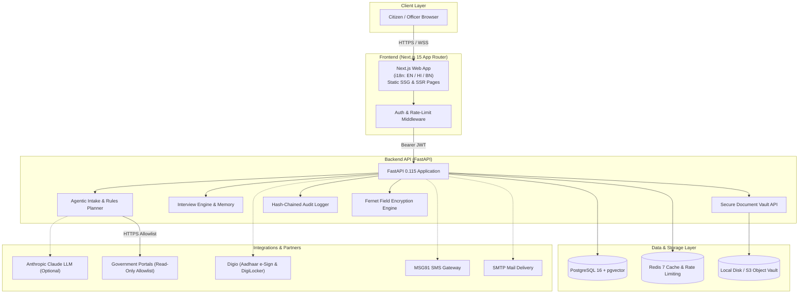

# Red Tape Navigator 🇮🇳

An agentic, AI-assisted civic intelligence and compliance platform designed to empower Indian citizens, entrepreneurs, and MSME owners to cut through bureaucratic red tape with clarity, confidence, and complete control.

Describe your goal in plain language:
> *"I want to open a small cloud kitchen in Kolkata"*  
> *"मुझे पुणे में बेकरी शुरू करनी है"*  
> *"আমি ঢাকায় নয়, কলকাতায় একটি ক্যাফে খুলতে চাই"*

Red Tape Navigator analyzes statutory regulations across national, state, and municipal jurisdictions, compiles an exact step-by-step compliance checklist with official fee and timeline citations, asks **only** for missing form fields in an adaptive multilingual interview, securely encrypts sensitive PII, fills official applications, and prepares downloadable PDFs and online portal key-in sheets.

> **Core Safety & Human-in-the-Loop Principle:**  
> **The citizen reviews, signs, and submits every application themselves.** The system never automatically submits applications to government portals, never bypasses human control, and never hallucinates legal fees or deadlines.

---

## 👥 Hackathon & Team Details

- **Project Name:** Red Tape Navigator
- **Team Name:** Onyx
- **Hackathon:** HackNPitch
- **Organising Institution:** Jadavpur University
- **Project Category:** Software / AI & Civic Tech
- **Repository:** [https://github.com/Anishgoswami-dev/Red_Tape_Navigator](https://github.com/Anishgoswami-dev/Red_Tape_Navigator)

### Team Members
1. **Raktim Chakraborty** (Team Leader)
2. **Anish Goswami**
3. **Rajdip Dhar**
4. **Imon Patra**

---

## 🌟 Key Features & Capabilities

```
┌─────────────────────────────────────────────────────────────────────────────┐
│                            CITIZEN / MSME JOURNEY                           │
├───────────────┬───────────────┬───────────────┬──────────────┬──────────────┤
│ 1. INTAKE     │ 2. PLANNER    │ 3. INTERVIEW  │ 4. REVIEW    │ 5. SUBMIT    │
│ Goal in EN/HI/│ 438 Rules, 8  │ Adaptive Form │ Side-by-Side │ Download PDF │
│ BN + Voice    │ Cities, Govt  │ Interview,    │ Preview,     │ & Key-in,    │
│ Input Option  │ Citations     │ Encrypted PII │ Verification │ Digio e-Sign │
└───────────────┴───────────────┴───────────────┴──────────────┴──────────────┘
```

1. **Multilingual Plain-Language Intake:**  
   Goal extraction powered by LLM with an automatic deterministic rules fallback. Supports English, Hindi (हिन्दी), and Bengali (বাংলা), alongside real-time browser voice input.
2. **Deterministic Rules & Knowledge Base:**  
   Maintains **438 rigorously verified rules** across 8 major Indian municipal corporations (Kolkata, Mumbai, Delhi, Bengaluru, Hyderabad, Ahmedabad, Chennai, Pune) and national central frameworks (Udyam, FSSAI FoSCoS, GST, Trade Licenses, Fire NOCs, Pollution Control, Shops & Establishments).
3. **Adaptive Interview Engine:**  
   Collects only what each specific form requires, eliminates duplicate questions, and validates inputs (Aadhaar checksum via Verhoeff algorithm, PAN regex, PIN codes, IFSC codes).
4. **Bank-Grade Data Protection & Privacy by Design:**  
   Compliant with the **Digital Personal Data Protection Act, 2023 (DPDP)**:
   - Separate, granular consent gates (`service`, `reminders`, `identity_providers`).
   - Self-service **Data Export (`my-data.json`)**, **Consent Withdrawal**, **Session Erasure**, and **Permanent Account Deletion**.
   - Field-level encryption using **Fernet (AES-128-CBC + HMAC-SHA256)** for Aadhaar, PAN, bank accounts, and TOTP secrets, with zero-downtime key rotation tooling.
   - Cryptographically linked **tamper-evident hash-chained audit log**.
5. **Secure Document Vault:**  
   Private citizen vault supporting PDF, PNG, and JPEG uploads (≤ 5MB) with magic byte validation, malware scanning integration, owner isolation, and storage adapters for local disks or S3-compatible cloud storage (AWS S3 / Cloudflare R2 / MinIO).
6. **Enterprise Security & Authentication:**  
   Argon2id password hashing, rotating JWT access/refresh tokens with reuse detection, mandatory email confirmation, TOTP Two-Factor Authentication (2FA) with single-use recovery codes, and brute-force lockout safeguards.
7. **Official PDF Generator & Portal Key-in Sheets:**  
   Fills official application PDFs and provides structured key-in copy sheets for online-only government portals (e.g., FoSCoS, Udyam) where direct PDF submission is not supported.
8. **Follow-up & Compliance Reminders:**  
   Citizen-triggered renewal and status check reminders scheduled across email (SMTP) and SMS (MSG91) with clear distinction between live provider delivery and local demo/mock queues.
9. **Staff & Officer Operations Console:**  
   Role-Based Access Control (`citizen`, `csc_operator`, `reviewer`, `admin`) with a live review queue, official form candidate verification, system & provider readiness monitoring (`/admin/readiness`), and retention purge controls.
10. **Production Operations & Disaster Recovery:**  
    Liveness and readiness endpoints (`/health/live`, `/health/ready`), Redis rate limiting with graceful in-memory degradation, structured JSON logging with 38-key PII/secret scrubbing, and automated non-production backup/restore verification tooling.

---

## 🏛 System Architecture



---

## 🛠 Technology Stack

### Backend
- **Framework:** FastAPI (Python 3.12, async ASGI)
- **Database ORM & Migrations:** SQLAlchemy 2.0 (asyncpg), Alembic, PostgreSQL 16 with `pgvector`
- **Cache & Task Queue:** Redis 7, Arq worker
- **Security & Cryptography:** `cryptography` (Fernet / MultiFernet), `argon2-cffi`, `python-jose`, `pyotp`
- **PDF & Image Processing:** `pypdf`, `pymupdf` (fitz), `Pillow`
- **Scraping & Allowlist Engine:** `httpx`, `beautifulsoup4`, strict government domain allowlists
- **Testing & Verification:** `pytest`, `pytest-asyncio`, `pytest-cov`, `ruff`, `mypy`, `structlog`

### Frontend
- **Framework:** Next.js 15 (React 19, App Router)
- **Localization:** `next-intl` (English, हिन्दी, বাংলা with 100% key and ICU placeholder parity)
- **Styling & UI:** Tailwind CSS, custom Indian tricolour aesthetic, Lucide-style SVG icons
- **Audio / Voice:** Web Speech API for real-time speech-to-text
- **Testing:** Vitest, Testing Library, TypeScript strict mode

---

## 🚀 Quick Start Guide

### Prerequisites
- **Python 3.12+** with `venv`
- **Node.js 20+** and `npm`
- **PostgreSQL 16** (or SQLite for local dev)
- **Redis 7** (optional; app degrades gracefully to in-memory caching and rate limiting)

---

### Step 1: Clone Repository
```bash
git clone https://github.com/Anishgoswami-dev/Red_Tape_Navigator.git
cd Red_Tape_Navigator
```

---

### Step 2: Backend Setup
```bash
cd backend

# Create and activate virtual environment
python -m venv .venv

# Windows (PowerShell):
.\.venv\Scripts\Activate.ps1
# Linux / macOS:
# source .venv/bin/activate

# Install dependencies
pip install -e ".[dev]"

# Create development environment configuration
cp ../.env.example .env

# Generate encryption keys and seed rules knowledge base
python -m app.kb.seed_loader

# Start development server
uvicorn app.main:app --reload --port 8000
```
The backend API is now running at `http://localhost:8000`.  
- Liveness check: `http://localhost:8000/health/live`
- Readiness check: `http://localhost:8000/health/ready`
- Swagger Docs (dev mode): `http://localhost:8000/docs`

---

### Step 3: Frontend Setup
```bash
cd ../frontend

# Install dependencies
npm install

# Start Next.js development server
npm run dev
```
Open your browser at `http://localhost:3000`.

---

### Step 4: Docker Compose (Full Stack Production Preview)
```bash
# From project root:
cp .env.prod.example .env.prod
# Fill in required production environment secrets in .env.prod

docker compose --env-file .env.prod -f docker-compose.prod.yml up -d --build
```

---

## 🧪 Comprehensive Verification Suite

Every change to Red Tape Navigator is tested against rigorous quality gates:

```bash
# Backend Quality Gates:
cd backend
ruff check .                                    # Linting & code standards
mypy app                                        # Static type checking (84 source files)
python -m pytest -q                             # 475 automated tests (95.34% coverage)
python -m evals.run                             # AI evaluation suite (26/26 cases, 0 hallucinations)
python ../scripts/rule_freshness.py --strict    # Rule freshness check (438/438 up-to-date)

# Frontend Quality Gates:
cd ../frontend
npm run lint                                    # ESLint checks (0 warnings)
npm run typecheck                               # Strict TypeScript verification
npm test                                        # Vitest unit test suite (10/10 passed)
npm run build                                   # Production SSG/SSR build (36 static routes)
```

---

## 🔒 Security, Compliance & Safety

- **No Auto-Submission:** Enforced at both architectural and API levels. All government filings are completed manually by the citizen.
- **DPDP Act (2023) Compliance:** Self-service consent management, data portability (`/privacy/export`), and cryptographic erasure (`/privacy/me`).
- **Cryptographic Audit Chain:** SHA-256 hash-chained immutable audit log with PostgreSQL advisory locking to prevent chain forks under concurrency.
- **Leak-Proof Logging:** 38 sensitive keys and inline Aadhaar, PAN, JWT, and connection string patterns are scrubbed from all logs and AI prompts.
- **Backup & Disaster Recovery:** Guarded PostgreSQL backup and restore verification utility (`scripts/db_backup_restore.py`) that strictly prohibits accidental restoration into production databases.

---

## 📂 Repository Structure

```text
Red_Tape_Navigator/
├── backend/
│   ├── app/
│   │   ├── agent/          # Goal parsing, LLM integration & fallback rules planner
│   │   ├── api/            # REST API endpoints (auth, consent, sessions, vault, admin)
│   │   ├── core/           # Security, Fernet crypto, audit logging, rate limiter
│   │   ├── db/             # SQLAlchemy models, sessions & database adapters
│   │   ├── followup/       # Submission checklist & reminder scheduling
│   │   ├── forms/          # Form filling engine, official PDF registry, key-in sheets
│   │   ├── i18n_content/   # Multilingual regulatory content (English, Hindi, Bengali)
│   │   ├── integrations/   # Adapters for Digio (e-Sign/DigiLocker), MSG91, SMTP
│   │   ├── interview/      # Adaptive conversational interview engine & validators
│   │   ├── jobs/           # Arq background worker (periodic rule refresh & purge)
│   │   ├── kb/             # 438 curated statutory rules & catalog
│   │   └── scraping/       # Guarded web scraper with government domain allowlist
│   ├── migrations/         # Alembic database migration scripts (0001 - 0009)
│   └── tests/              # 475 test cases covering security, privacy & workflows
├── frontend/
│   ├── app/                # Next.js 15 App Router pages (i18n localized)
│   ├── components/         # React components (SessionView, Vault, Help, Console)
│   ├── messages/           # Complete translations (en.json, hi.json, bn.json)
│   └── tests/              # Vitest test suite for i18n & API client
├── docs/                   # Architectural blueprints, security & compliance audits
├── scripts/                # Database backup/restore, encryption key rotation, freshness
├── docker-compose.prod.yml # Production multi-container Docker specification
├── render.yaml             # Render Blueprint infrastructure definition
└── README.md               # Main project documentation
```

---

## 📄 License & Legal Notice

This project is open-source and created for **HackNPitch 2026** at **Jadavpur University**.

> **Disclaimer:** Red Tape Navigator provides AI-assisted administrative guidance and form automation. It does not constitute official legal advice. Citizens must verify specific requirements, fees, and timelines with the relevant government authorities before submission.
