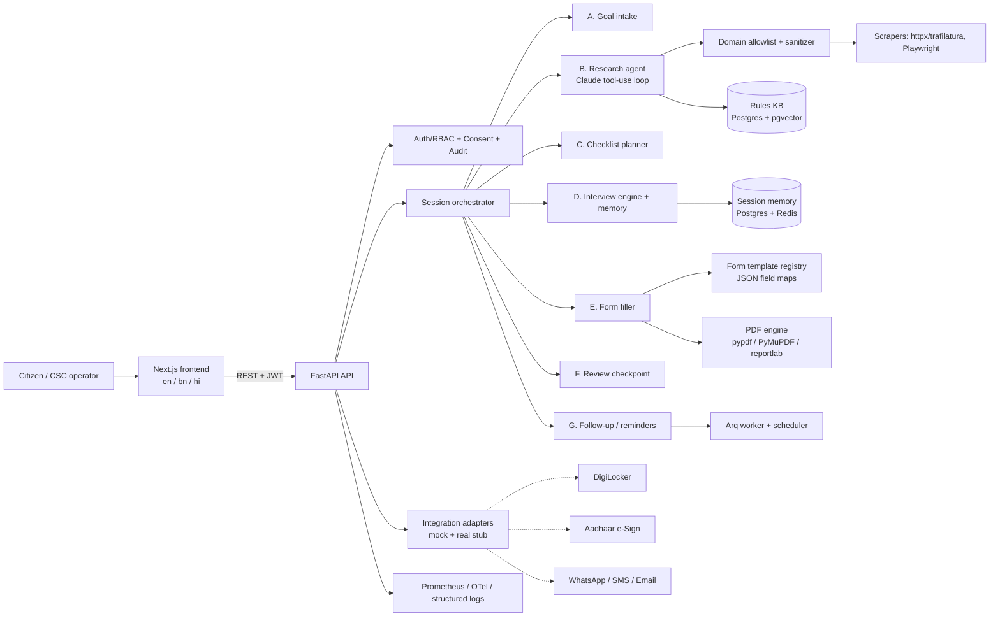

# Architecture

Red Tape Navigator is a monorepo: `/backend` (FastAPI), `/frontend` (Next.js), `/infra` (Docker/Terraform),
`/docs`, `/scripts`.



## Key design rules

1. **No autonomous submission.** There is no adapter method or route that posts to a government portal.
   The final step produces PDFs + a checklist; the citizen performs submission. Enforced by tests
   (`tests/test_no_submission.py`) that scan the code for submit capability.
2. **No claim without a citation.** `Claim` requires `source_url`, `fetched_at`, `content_hash`; the DB
   column is NOT NULL and the evaluation harness fails on uncited claims.
3. **Scraped content is data.** Fetched text passes the sanitizer, is delimited in prompts, and the LLM has
   no tool that can act on it beyond constrained, allowlisted tools.
4. **Never guess values.** The form filler emits `missing`/`doubtful`/`unmapped` flags instead of defaults.
5. **Sensitive fields (Aadhaar, PAN) are Fernet-encrypted at rest and redacted in logs.**
6. **Graceful degradation.** Without an `ANTHROPIC_API_KEY` the agent falls back to a deterministic
   rules-pack (curated seed KB) so the demo works offline; this is labelled in the UI.

## Backend layout

```
backend/app/
  core/        config, security (JWT, crypto), logging, metrics, resilience (retry/circuit breaker), rate limit
  db/          async engine, models, session
  api/         routers: auth, consent, sessions, research, interview, forms, review, followup, admin, health
  agent/       llm client, tool loop, intake, research, planner, prompts
  scraping/    allowlist, fetcher, robots, sanitizer
  kb/          rules knowledge base, versioning, diffing, embeddings
  interview/   field catalogue, validators, engine, i18n questions
  forms/       registry, templates/*.json, pdf fill (acroform + overlay), report
  integrations/ interfaces, mock, real stubs
  followup/    reminders, notifiers
  jobs/        worker tasks (refresh, purge, reminders)
backend/evals/ golden cases + harness
```

## Data flow (happy path)

Goal text → intake parse (state/city) → research (KB hit or scrape) → claims with citations/confidence →
ordered checklist → union of form fields → interview (only missing) → fill PDFs + field report →
review UI (edit, consent) → download + submission checklist → reminders.
